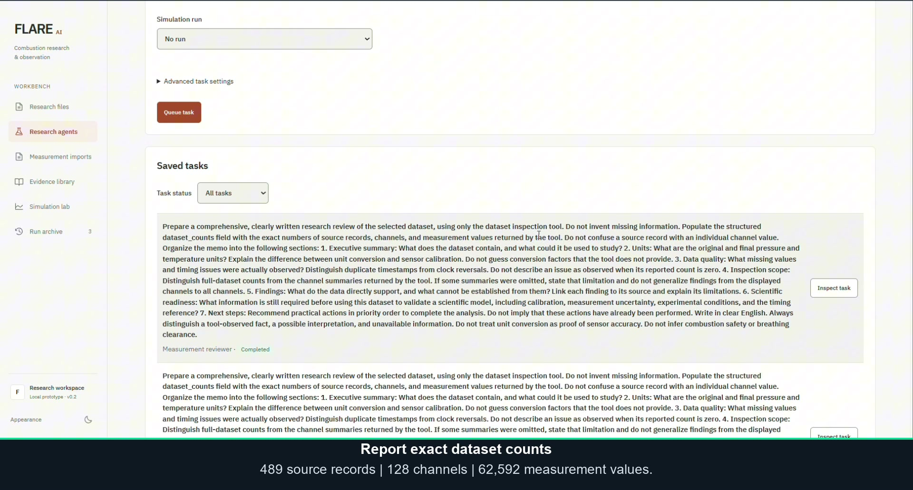

# FLARE AI

**Team KHAYAL | NASA Space Apps | Flame in Freefall**

A research workbench that helps users inspect combustion measurements, trace findings to their sources, and explore a proposed fire-suppression verification workflow in microgravity.

## Project presentation and demo

**[Read the English presentation (7 slides)](presentation/FLARE-AI-Presentation.pdf)** · **[Watch the English demo](media/flare-ai-demo.mp4)** · **[Download the video](https://raw.githubusercontent.com/cc4958507-ship-it/FLARE-AI/main/media/flare-ai-demo.mp4)**

[](media/flare-ai-demo.mp4)

The demo is **28.4 seconds**, has **no audio track**, and includes **English on-screen explanations**. The presentation, video and repository are public and can be accessed without signing in. If GitHub does not show a video player, use the download link.

## The problem and our approach

Visible flame alone cannot explain every combustion condition in microgravity. Researchers also need measurement context, reliable units, timing information and experimental evidence. FLARE AI brings these into one workbench and keeps missing data and scientific limitations visible.

Users browse research sources, select a measurement dataset, inspect its channels and timing flags, and ask a bounded research agent for a source-linked review. A separate educational simulation demonstrates the proposed monitoring and verification workflow. Its synthetic outputs do not establish real-world fire safety or breathing clearance.

## How we actually used NASA data

- **FLEX-007 / PSI-69:** imported 1,112 measurement rows across seven channels, retained missing values and source references, and provided a recorded-observation viewer. NASA cool-flame findings informed the project's focus on evidence beyond visible flame. See the [FLEX import notes](docs/NASA-FLEX-007.md) and [NASA source DOI](https://doi.org/10.60555/mbq8-0451).
- **Supplied ACME and chamber files:** imported three native datasets containing 62,646 source records and 2,238,087 channel values. The workbench preserves original values and timestamps, supports exact paging and channel plots, and makes dataset statistics available to the measurement-review agent.
- **Data checks:** converted explicitly documented chamber pressure and temperature units, flagged repeated timestamps, and left undocumented ACME units unresolved. Unit conversion does not establish sensor calibration.
- **Traceability:** cataloged 80 original research assets with checksums. Native files were supplied by the team; their provenance and licensing still need independent review. Large source assets are kept outside Git and require the [data integration and backup procedure](docs/RESEARCH-DATA-INTEGRATION.md).

The physical simulation has **not** been calibrated against these measurements. Imported observations remain separate from synthetic verification decisions.

## What the demo shows

1. A saved research question enters the persistent agent queue.
2. The measurement reviewer inspects the attached chamber dataset.
3. The completed review reports 489 source records, 128 channels and 62,592 measurement values.
4. Findings retain source references, missing information and scientific limitations.

The application defaults to English and also supports Arabic through its language selector. Running the interactive workbench requires the local setup below; the repository link provides the project materials and code.

## Planned Evaluation

- Compare the proposed verification workflow with camera-only and static-threshold baselines using independent reference measurements; measure false verification, false alarms and detection delay.
- Evaluate missing channels, frozen readings, replay and timing faults, while distinguishing synthetic tests from real-instrument validation.
- Test whether suggested additional measurements reduce uncertainty on held-out experiments, with human review before operational use.

These scientific comparisons are planned. Software tests cover application behavior; they do not calibrate instruments or validate a physical model. Experimental calibration, broader agent-grounding evaluation, semantic retrieval and production deployment remain future work.

## Run with Docker

Requirements: Docker Engine and Docker Compose.

```bash
cp .env.example .env
docker compose up --build
```

Open **http://localhost:8100**. API documentation: **http://localhost:8100/docs**.

PostgreSQL is internal to Compose; the web port binds to loopback. The named `postgres_data` volume preserves scenarios, evidence snapshots, approved plans, frames and event history. Stop with `docker compose down` without `-v` to keep data. No account or Kie key is required for offline mode.

On a network using a custom certificate authority, pass the combined CA bundle as a BuildKit secret, without disabling TLS:

```bash
docker build --secret id=proxy_ca,src=/path/to/combined-ca.pem -t flare-ai:0.2.0 .
docker compose up --no-build
```

## Run without building an app image

Requirements: Python 3.12+, Node 22+, PostgreSQL 17. The commands below use a task-local Python environment.

```bash
docker run -d --name flare-postgres \
  -e POSTGRES_USER=flare -e POSTGRES_PASSWORD=flare_local_demo \
  -e POSTGRES_DB=flare -p 127.0.0.1:5432:5432 postgres:17.2-alpine
python -m venv work/venv
work/venv/bin/pip install -r backend/requirements.lock.txt -e './backend[test]'
npm ci --prefix frontend
npm run build
npm run dev
```

The API serves the compiled frontend and all API routes on port 8100. The development launcher applies migrations and runs the worker. For frontend hot reload, run `npm --prefix frontend run dev` in another terminal; Vite proxies `/api` to port 8100.

Set `DATABASE_URL` if your database differs. For a fully locked Python environment, `uv sync --project backend --frozen --extra test` can be used instead of pip; adapt the executable paths accordingly.

## What works

- Arabic/English interface switching with saved preference, RTL layout, translated research summaries and Arabic printable report labels. Original measurement units, identifiers and source files retain their values. See [the readiness and remaining-work review](docs/READINESS-2026-11-15.md) for the actual AI capabilities and live-account requirements.

- Six provenance-labeled source/model records with search, research-family filtering, investigation details, references and explicit unknown fields.
- Side-by-side comparison of two or three records, with quantitative comparison restrictions.
- Structured scenarios, persisted evidence snapshots, offline source explanations, versioned monitoring plans, and explicit approval before run creation.
- Seeded one-second synthetic observations. Reduce/stop events alter future dynamics once. Manual intervention and event-schedule presets use the same generator.
- Danger / Uncertain / Verified engine with observation windows, channel coverage, danger latching, clearance and hold timing. Atmosphere and data quality remain separate.
- Background virtual clock at 1× / 4× / 16×, pause/resume, required CO-channel dropout, independent branches, decision trace and event ledger.
- Durable PostgreSQL frames/events, command idempotency, database row locking and atomic worker batches. Multiple worker processes are guarded by per-run clock slots and row locks.
- JSON snapshots and printable HTML reports with source references, all observed samples and event history.
- Light/dark themes, native keyboard controls/dialogs, a complete measurement table, responsive layouts and bundled IBM Plex fonts.
- SSE audit/measurement-commit stream with `Last-Event-ID`. The current React UI polls snapshots every second and the ledger every 1.5 seconds; SSE is available to other clients.

## Verify

Start PostgreSQL before backend integration tests. Tests automatically use a separate `flare_test` database with the local credentials above. For other environments, provide a dedicated `TEST_DATABASE_URL`; it must never point at production.

```bash
work/venv/bin/python -m pytest backend/tests -q
npm run build
# Start the app and worker first, then:
npm run test:e2e
```

Browser tests use the installed Chromium at `/usr/bin/chromium`. On another machine, update `frontend/playwright.config.ts` to use its browser executable or Playwright-managed browser. Screenshots/traces and test JSON are written under `work/`.

Generate TypeScript API declarations after schema changes:

```bash
curl http://localhost:8100/openapi.json -o frontend/openapi.json
frontend/node_modules/.bin/openapi-typescript frontend/openapi.json -o frontend/src/generated-api.d.ts
```

## Model configuration

Offline is the default and visibly identifies reviewed source summaries. To enable the implemented Kie Responses adapter, set `AI_MODE=live` and a server-only `KIE_API_KEY` in `.env`, then recreate the API container. `KIE_MODEL=gpt-6-1-sol` and `/codex/v1/responses` follow the supplied document. The adapter validates output shape and evidence IDs and falls back on invalid output or provider failure. It never computes state or executes an intervention. A live account smoke test verified GPT-6.1 Sol discovery and source-linked explanation through the running application. Native provider JSON-schema enforcement and billing reconciliation remain unverified. No API key is bundled or stored in browser code.

## Scope and remaining work

NASA **FLEX-007 / 20CAL13** is now available under `/datasets`: seven channels of supplied image-analysis measurements, original source downloads, DOI/license, per-value source locations and a recorded-observation viewer. See [the NASA import notes](docs/NASA-FLEX-007.md). It is an experimental **Replay Only** dataset; the synthetic model has not been calibrated against it.

The November 14 extension adds [measurement imports and advanced synthetic sensor faults](docs/IMPLEMENTATION-PROGRESS.md). Open `/datasets` to import explicitly mapped long-form CSV files. Original CSV, provenance declarations, validation reports and normalized relational measurements are preserved separately from simulation runs. Imported data remains **Replay Only**. General NASA archive adapters, scientific calibration and the other remaining items listed in that progress document are not complete.

This is the connected local P0 research workflow, not a scientific release. Additional PSI formats, experimental calibration, semantic retrieval, real-instrument freeze/replay/skew/saturation diagnostics, live-provider capability/budget certification and production authentication remain incomplete. Bounded research agents already have persistent tasks, retry rules, lease recovery and server-side admission controls; see the [agent readiness report](docs/AGENT-READINESS-2026-11-15.md). Database records are JSON-backed versioned snapshots with append-only observed frames and events, rather than the full normalized research schema proposed in the document. Lexical retrieval searches the small in-memory source index; PostgreSQL stores the workflow and measurements.

The generator restarts from seed and event history for each small batch; the one-run horizon is bounded at 240s. This deliberately favors transparent replay over high-throughput streaming. The browser currently loads the complete short run series. Imported real-world data cannot be sent through these synthetic endpoints to obtain a verification claim.

Hosting: keep the specified Python/PostgreSQL stack on a container-capable host. A static Sites deployment would not run this backend, so this delivery preserves the full local application instead of publishing an incomplete frontend.

Read [the demo walkthrough](docs/DEMO.md), [data manifest](docs/DATA-MANIFEST.md), [design rationale](docs/DESIGN-NOTES.md), and [validation report](docs/VALIDATION.md).

## Backup and restore

```bash
docker compose exec -T db pg_dump -U flare -d flare -Fc > flare.dump
# Restore into a separate empty database for verification:
docker compose exec -T db createdb -U flare flare_restore
docker compose exec -T db pg_restore -U flare -d flare_restore < flare.dump
```

The first launch seeds three clearly labeled, pre-approved demo runs through the same generator and verification engine. New research scenarios require your explicit plan approval.


### Managed TLS certificate bundle

If the runtime uses a managed HTTPS proxy, set `FLARE_CA_BUNDLE` to a trusted combined CA bundle in the ignored `.env` file, then retain the runtime override when recreating the API:

```bash
docker compose -p flare-demo -f compose.yaml -f compose.tls.yaml up --no-build -d
```

The bundle mounts read-only; TLS verification remains enabled. On an ordinary host that uses public CA roots, the base Compose file is sufficient. The key stays server-side in the ignored, permission-restricted `.env` file.
