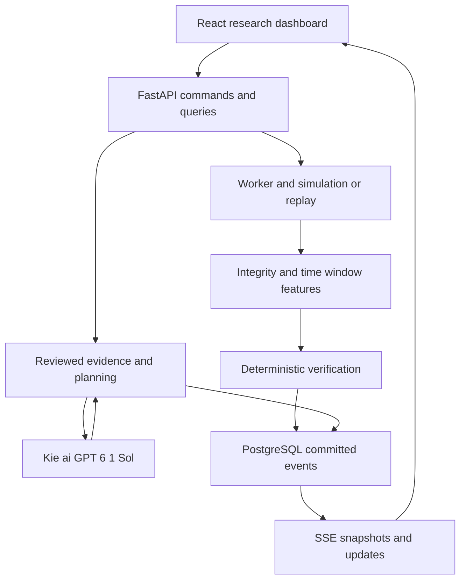

# FLARE AI Full Implementation Document

## وثيقة تنفيذ البروتوتايب

مشروع khayal nasa | الإصدار 1.0 | 14 نوفمبر 2026

**القرار المقترح:** نبني منصة بحثية تفاعلية لاستكشاف تجارب الاحتراق ومقارنتها وتفسيرها، مع مختبر محاكاة يربط التدخل بقياسات جديدة وحالة قابلة للتفسير. نعتمد React و TypeScript و FastAPI و PostgreSQL، ونستخدم **Kie.ai مع GPT 6.1 Sol** وفق اختيار صاحب المشروع.

تشرح الوثيقة ماذا سنبني، وكيف تتصل مكوناته، وما البيانات المطلوبة، وكيف نختبر السلوك، وما الذي نحتاجه لتشغيل نسخة يمكن عرضها وإعادة تشغيلها. النص عربي، وتبقى أسماء الحقول والعقود البرمجية بالإنجليزية لتسهيل التنفيذ.

هذه وثيقة تصميم وتنفيذ وليست تقريرًا عن تطبيق تم بناؤه. لم تُنفذ في هذا التسليم اتصالات مدفوعة مع Kie، ولم تُنزّل ملفات القياس الخام من PSI. أمثلة العقود والقواعد الواردة مواصفات للبناء؛ أرقام المحاكاة تعليمية ولا تمثل حدود سلامة معتمدة.

### ما الذي يجب أن يراه المستخدم في النسخة الأولى

1. يجد تجربة مناسبة، ويعرف ظروفها ومصدرها والمعلومات الناقصة فيها.
2. يقارن تجربتين أو ثلاثًا دون إخفاء الفروق بين الوقود والجاذبية والهندسة.
3. ينشئ سيناريو، ويراجع خيارات تدخل وخطة مراقبة مرتبطة بالأدلة.
4. يوافق على تدخل داخل المحاكاة، ثم يرى القياسات والقرار يتغيران بسببه.
5. يفتح سجل القرار، ويتتبع كل ادعاء إلى مصدر أو قياس أو افتراض معلن.

**الأولوية:** اكتمال الرحلة السابقة وقابليتها لإعادة التشغيل. جودة المحاكاة الفيزيائية والتحقق التجريبي مرحلتان مستقلتان عن نجاح البرمجيات.

### القرارات الأساسية

| الموضوع | قرار النسخة الأولى |
| --- | --- |
| المنتج | Research Dashboard مع Simulation Lab |
| الجمهور | باحث احتراق أو مهندس يراجع سيناريو بحثيًا |
| مسار العرض | قطرات سائلة مستوحاة من سؤال FLEX مع محاكاة معلنة |
| نموذج اللغة | GPT 6.1 Sol عبر Kie.ai |
| حساب الحالة | محرك قواعد حتمي بإصدار معروف |
| التشغيل | Docker Compose مع وضع عرض يعمل دون اتصال بالمودل |
| تسليم البناء لاحقًا | مستودع، بيانات مصغرة، تشغيل موحد، اختبارات، وديمو موثق |

<!-- page -->

# فهرس المحتويات

الوثيقة منظمة حسب قرارات المنتج والبيانات والتنفيذ والتحقق. يتيح ملف Word التنقل بين العناوين مباشرة.

| القسم | الموضوع | القسم | الموضوع |
| --- | --- | --- | --- |
| 01 | فهم المشروع ومراجع المتطلبات | 16 | جودة البيانات ودمج الإشارات |
| 02 | النطاق ومعيار اكتمال البروتوتايب | 17 | ملف التحقق التعليمي |
| 03 | رحلة المستخدم وشاشات المنتج | 18 | انتقالات الحالة وثلاثة مؤشرات مستقلة |
| 04 | اختيار التقنيات | 19 | عقود الواجهة البرمجية |
| 05 | البدائل وحدود التوسع | 20 | أمثلة القياس والحدث والاستئناف |
| 06 | البنية ومسار البيانات | 21 | مواصفات الواجهة والتقرير |
| 07 | مصادر البيانات وخطة الفحص | 22 | تنظيم المستودع وعقد التشغيل |
| 08 | استيعاب الملفات وتطبيع القياسات | 23 | اختبارات تثبت السلوك |
| 09 | نموذج البيانات | 24 | التقييم العلمي والمقاييس |
| 10 | القيود والفهارس وقابلية الاستعادة | 25 | الأمان والتشغيل والمراقبة |
| 11 | استرجاع الأدلة وترتيب التجارب | 26 | النشر والأداء وخطة الفشل |
| 12 | Kie ai مع GPT 6 1 Sol | 27 | خطة التنفيذ والمهام |
| 13 | عقد المودل والأخطاء وتكلفة الاستخدام | 28 | القرارات المفتوحة وشروط التسليم |
| 14 | منسق العمل وخطة التدخل | 29 | المصادر وطريقة استخدامها |
| 15 | محاكاة تؤثر فيها الأفعال | 30 | مراجع التقنية والتكامل |

قراءة مقترحة سريعة: فهم المنتج والنطاق، ثم التقنيات والبنية، ثم تكامل Kie، ثم المحاكاة والتحقق، ثم العقود وخطة التنفيذ.

<!-- page -->


# 01 فهم المشروع ومراجع المتطلبات

الملفات الثلاثة تصف مشكلة مترابطة: صعوبة نقل نتائج أبحاث الاحتراق إلى سيناريو محدد، ثم صعوبة إثبات توقف المصدر بعد اختفاء اللهب. التصور الكامل يضيف توضيحًا حاسمًا: أساس المنتج هو تلخيص تجارب PSI وترتيبها وتفسيرها، ومسار الإخماد والتحقق تطبيق بحثي داخل هذا الأساس. [U1 ص 1–8، U2 ص 1–4، U3 ص 1–5]

لذلك نقسم المنتج وظيفيًا إلى مكتبة تجارب، ومساحة تحقيق، ومختبر زمني. المكتبة تجعل البيانات قابلة للفهم؛ مساحة التحقيق توضح مدى انطباق الأدلة؛ والمختبر يختبر أثر تدخل داخل نموذج معلن. لا تكفي شاشة غازات متحركة وحدها لإكمال المشروع.

| المطلب | أصله في الملفات | التنفيذ الذي يحققه |
| --- | --- | --- |
| Summarize و Rank و Interpret | U1 ص 7 و U2 ص 4 | بطاقات تجارب، ترتيب مفسر، تفسير موثق |
| مقارنة الظروف | U1 ص 3 و 8 | حقول منظمة وفروق ظاهرة وحالات عدم انطباق |
| خطة تدخل وخطة تحقق معًا | U3 ص 1 | Plan بإصدار ومعايير وقنوات مطلوبة |
| حلقة مغلقة | U3 ص 2 | فعل محاكاة يغير المستقبل ثم يعيد التقييم |
| فصل اللغة عن حساب الحالة | U3 ص 2 | LLM adapter منفصل عن Verification Engine |
| ثلاثة مؤشرات مستقلة | U1 ص 5 و U3 ص 3 | احتراق، تلوث، جودة بيانات |
| ثلاث نهايات للعرض | U1 ص 5 و U3 ص 4 | خطر مستمر، تحقق مشروط، نقص موثوقية |
| قياس مستقل واختبار منفصل | U2 ص 3 | حقيقة مرجعية محجوبة ومجموعات تطوير واختبار |

### الأساس العلمي الذي نستخدمه

تصف NASA استمرار احتراق منخفض الحرارة في بعض تجارب قطرات FLEX بعد اختفاء اللهب المرئي. يدعم ذلك سؤال التحقق، ضمن ظروف التجربة المحددة؛ لا يحول كل حرارة متبقية إلى دليل احتراق. وتصف أبحاث CPM مراقبة غازات متعددة، كما تناقش دراسة مستقلة التنقية والمراقبة بعد الحريق. [R3، R5، R6]

**قاعدة تفسير:** نقسم المعلومات إلى Experimental Evidence و Model Result و Scientific Inference و Unknown. ويضاف لها مصدر البيانات: NASA raw أو NASA metadata أو curated literature أو synthetic. التصنيف العلمي ومصدر البيانات حقول مختلفة.

أي فكرة لا توجد لها أدلة كافية تبقى فرضية أو فجوة. لا ننسب خوارزمية FLARE أو دقتها أو حالات Danger و Verified إلى NASA.

<!-- page -->

# 02 النطاق ومعيار اكتمال البروتوتايب

### النسخة المطلوبة للعرض

يشمل P0 فهرسًا من ست إلى ثماني بطاقات تحقيق مراجعة، ومقارنة حتى ثلاث بطاقات، وبحثًا باللغة الطبيعية أو حقول منظمة، ومساحة سيناريو، وتدخلين اصطناعيين مختلفي الأثر، وتشغيلًا زمنيًا، وثلاث نهايات، وتصدير سجل JSON وتقرير HTML قابل للطباعة. لا يشترط أن تتوفر سلسلة زمنية حقيقية لكل بطاقة.

تغطي المكتبة عائلات مختلفة لفهم المشهد، لكن المحاكاة الأولى تحصر نفسها في ملف واحد لقطرة وقود سائل وهندسة واحدة. لا نجمع BASS و FLEX في ملف تحقق مشترك. إذا لم تتوفر بيانات PSI الخام، تبقى بطاقاتها بطاقات معلومات مع المصدر، وتبقى رسوم المحاكاة تحت عنوان Synthetic Demo.

| المستوى | ما نبنيه | شرط اعتباره مكتملًا |
| --- | --- | --- |
| P0 المكتبة | تصفية، ترتيب، مقارنة، مصدر لكل حقل رئيسي | لا أرقام مخترعة ولا حقول مجهولة معبأة تلقائيًا |
| P0 المحاكاة | تشغيل وإيقاف وتسريع وتدخل وأعطال | نفس البذرة والأحداث تعطيان نفس النتيجة |
| P0 الحالة | قواعد وتفسير وسجل وإعادة تشغيل | تحقق المعايير آليًا دون رأي المودل |
| P0 الذكاء | Kie Sol يشرح الأدلة ويقترح خطة | مخرجات متحققة ومراجع صالحة و fallback ظاهر |
| P1 بيانات حقيقية | استيراد تشغيل NASA واحد | فحص ملفات ووحدات وتوقيت وحقوق الاستخدام |
| P1 استرجاع دلالي | embeddings محلية و pgvector | تحسن قابل للقياس على أسئلة مراجعة |
| P2 بحث متقدم | نماذج تعلم أو معايرة تجريبية | بيانات مستقلة وتصميم تقييم متخصص |

### ما يؤجل

التحكم بمعدات حقيقية، واعتماد السلامة، وإصدار تصريح تنفس، والمحاكاة الكيميائية التفصيلية، وتدريب نموذج كشف فيديو، وتعدد المؤسسات والصلاحيات المعقد، وتشغيل أسطول مستقل من الإيجنتس. يمنع تصميم الـ API في P0 أي اتصال بمشغلات مادية.

### معنى شغّال

التطبيق يخزن السيناريو والخطة والقراءات والقرارات، ويستعيدها بعد تحديث الصفحة وإعادة تشغيل الخدمات. تغيير التدخل يغير ناتج المحاكاة؛ وتعطل Kie لا يوقف تدفق القياسات. يميز التقرير بين مخرجات البرمجيات والنتائج العلمية التي لم تُختبر بعد.

نجاح بيانات اصطناعية يثبت تحقق السلوك البرمجي على هذه البيانات فقط. إدخال بيانات حقيقية دون قنوات تحقق مناسبة يعطي Replay Only أو Uncertain، ولا يسمح باستعارة ملف المحاكاة لإعلان تحقق علمي.

<!-- page -->

# 03 رحلة المستخدم وشاشات المنتج

### رحلة يمكن عرضها خلال خمس دقائق

يبدأ الباحث بسؤال عن الانطفاء الظاهري لقطرة وقود في الجاذبية الصغرى. تظهر له التجارب المرتبطة بالسؤال، ويختار FLEX، ثم يراجع ملخصًا ومصادره وحدود ما نعرفه. يضيف تجربة أخرى للمقارنة، ويرى أن اختلاف الوقود أو القنوات قد يمنع المقارنة الكمية.

ينتقل إلى سيناريو محدد، ويسترجع الأدلة، ويراجع خطة مراقبة. يختار تدخلًا اصطناعيًا محدود الأثر، ويوافق على تشغيله. تختفي إشارة اللهب، لكن بقية المؤشرات تبقي الحالة Danger. ينشئ فرعًا من نقطة التدخل ويختار أثرًا فعالًا؛ بعد فترة تحقق مكتملة تظهر Verified within simulated conditions، مع بقاء مؤشر الملوثات منفصلًا. في فرع ثالث يؤدي انقطاع قناة مطلوبة إلى Uncertain.

| الشاشة | المحتوى الرئيسي | الإجراء |
| --- | --- | --- |
| Explore | قائمة تجارب وفلاتر وسبب الترتيب | فتح تجربة أو إضافتها للمقارنة |
| Investigation | ظروف ونتائج وقنوات وروابط أدلة | إنشاء سيناريو أو فتح المصدر |
| Compare | صفوف متطابقة للخصائص مع الفروق | اختيار حد مقارنة صالح |
| Scenario | وقود وهندسة وبيئة وأسئلة ناقصة | حفظ نسخة واسترجاع الأدلة |
| Plan | خيارات وخطة قياس ومعيار تحقق | اعتماد خطة محددة |
| Lab | ثلاث حالات ورسوم زمنية وأحداث | تطبيق تدخل أو حقن عطل اصطناعي |
| Run report | تسلسل القرارات والمراجع والإصدارات | تنزيل تقرير أو إعادة التشغيل |

### سلوك الواجهة المطلوب

يظهر أصل البيانات ملازمًا للعنوان والرسم والتقرير. كل قيمة لها وحدة ومصدر أو إشارة Unknown. رسوم القنوات المفقودة تعرض فجوة ولا تصل النقاط عبرها. الضغط على قرار يبين القياسات التي أدت إليه، والقواعد التي مرت أو فشلت، وإصدار الخطة.

تبدأ واجهة العرض بالإنجليزية للمصطلحات العلمية، مع نصوص عربية اختيارية عبر ملفات ترجمة. تبقى المحاور والأرقام من اليسار لليمين حتى في الوضع العربي. الحالات موصوفة بالنص والرمز مع اللون، وتتوفر الجداول بديلًا للرسوم. تدعم الأزرار لوحة المفاتيح، وتبقى تحديثات البث هادئة لقارئ الشاشة؛ يعلن تغير الحالة فقط.

يفصل التطبيق بين Reset View الذي لا يغير البيانات و New Branch الذي ينشئ run جديدًا. التعديل على الماضي لا يكتب فوق سجل سبق تصديره.

<!-- page -->

# 04 اختيار التقنيات

نختار تطبيق ويب من واجهة React وخادم Python واحد ذي وحدات واضحة، وقاعدة PostgreSQL. تشغيل التحليل والمزامنة والمحاكاة في Python يقلل ازدواج المنطق، بينما تبقى إدارة التفاعل والعرض في TypeScript. هذه اختيارات هندسية للمشروع، وليست ادعاءً بأن خيارًا واحدًا أفضل لكل الأنظمة.

| الطبقة | الاختيار | سبب الاستخدام |
| --- | --- | --- |
| الواجهة | React 19 و TypeScript و Vite | لوحة تفاعلية بلا حاجة حالية إلى SEO أو SSR |
| التنقل | React Router | روابط مستقرة لكل تجربة وسيناريو وتشغيل |
| بيانات الواجهة | TanStack Query | جلب وتخزين مؤقت وإبطال واضح بعد التعديلات |
| المكونات | CSS tokens و Radix primitives عند الحاجة | وصول جيد وتحكم بالشكل دون مكتبة ضخمة |
| الرسوم | Apache ECharts | محاور متزامنة و zoom وأحداث زمنية |
| الخادم | Python 3.12 و FastAPI و Pydantic | API موثق وعقود وأنواع وفصل تحليل الإشارات |
| الحساب | NumPy و SciPy و pandas | تنظيف وتحويل ونوافذ زمنية قابلة للاختبار |
| التخزين | PostgreSQL 17 و SQLAlchemy 2 و Alembic | معاملات وعلاقات وإصدارات وترحيلات |
| الاسترجاع | PostgreSQL full text أولًا | مناسب لمجموعة الأدلة المصغرة [T3] |
| المودل | Kie.ai و GPT 6.1 Sol | اختيار المستخدم مع adapter خلفي مخصص |
| تشغيل المهام | worker Python من نفس الصورة | استمرار المحاكاة والمهام بعد إغلاق المتصفح |
| النقل | REST للأفعال و SSE للتحديثات | اتجاه بث واحد مع استئناف [T2] |
| التغليف | Docker Compose | تشغيل الخدمات والـ volumes معًا [T5] |
| الاختبار | pytest و Hypothesis و Vitest و Playwright | ثوابت المحرك وعقود API ورحلة مستخدم كاملة |

### سياسة الإصدارات

الأرقام أعلاه خطوط توافق مقترحة. عند التأسيس نثبت إصدارات دقيقة مجربة في pnpm-lock.yaml و uv.lock، ونثبت صور Docker بالنسخة والـ digest في إصدار العرض. لا نستخدم latest في تشغيل قابل لإعادة الإنتاج. عند استخدام SSE المدمج في FastAPI نختار إصدارًا يدعم fastapi.sse؛ توثيقه يذكر إضافته منذ 0.135.0. [T2]

### لماذا Vite مع FastAPI

المنتج لوحة بحثية، والتحليل Python موجود أصلًا. لا نحتاج خادم Next.js ثانيًا لإعادة توجيه نفس الطلبات. React يوثق بناء التطبيقات باستخدام أدوات مثل Vite؛ نتحمل هنا مسؤولية اختيار الراوتر وجلب البيانات لأن النطاق صغير ومحدد. [T1]

<!-- page -->

# 05 البدائل وحدود التوسع

| البديل | الفائدة | قرار المشروع |
| --- | --- | --- |
| Next.js | SSR وخادم واجهة متكامل | يؤجل لوجود صفحات عامة تتطلب ذلك |
| Streamlit | بناء تجربة تحليلية بسرعة | يصلح لاستكشاف البيانات؛ لا نعتمده لرحلة المنتج النهائية |
| Node backend فقط | لغة واحدة | يضاعف نقل حسابات علمية نريدها في Python |
| SQLite | إعداد محلي بسيط | مناسب لاختبار وحدات؛ لا نضيفه كمسار تخزين ثان للنسخة |
| Supabase | PostgreSQL وإدارة هوية جاهزة | بديل استضافة لاحق إذا احتجنا إدارة مستخدمين |
| Pinecone أو قاعدة متجهات منفصلة | توسع استرجاع مستقل | غير ضروري لحجم المجموعة الأولى |
| LangGraph أو CrewAI | تنظيم مسارات ديناميكية | نبدأ workflow صريحًا؛ نضيف إطارًا عند وجود حاجة مقاسة |
| Redis و Celery | صفوف ومهام متعددة العقد | يؤجلان؛ worker وقاعدة البيانات يكفيان للنطاق المحدد |
| Kafka و TimescaleDB | تدفقات زمنية كبيرة | حجم الديمو لا يبرر العبء التشغيلي |

### نمو محسوب

تستخدم النسخة الأولى قاعدة واحدة، وصورة backend واحدة يشغل منها API و worker. تخزن الملفات الكبيرة في volume محلي ضمن تركيب واحد. عند نقل الخدمات إلى عقد منفصلة نستخدم object storage ونحفظ مراجع الملفات في القاعدة. لا نعتمد قرصًا محليًا مشتركًا بالصدفة بين استضافات مستقلة.

نضيف pgvector عند إثبات أن البحث الدلالي يحسن الاسترجاع. مكتبة pgvector تدعم البحث المتجهي داخل PostgreSQL؛ نبدأ بالبحث الدقيق لمجموعة صغيرة قبل إضافة HNSW الذي يبادل بعض الاستدعاء بالسرعة. [T4]

لا نفترض وجود embeddings عبر Kie لـ Sol. في P0 البحث نصي ومنظم؛ وفي P1 نختبر نموذج embeddings محليًا بعد التحقق من رخصته وجودة البحث العربي والإنجليزي، دون إضافة مزود مدفوع يخالف اختيار المستخدم.

### متى نعيد النظر

إذا استغرقت استعلامات القنوات أكثر من الهدف على الحجم المحدد، نضيف downsampling وفهارس قبل قاعدة جديدة. إذا تراكمت مهام الـ worker نضيف عمالًا مع leases قبل وسيط رسائل. إذا لم تحقق مخرجات Sol معيار الاستناد إلى الأدلة، نصلح الاسترجاع والعقد ونقيس مجددًا؛ لا نبدل المودل بصمت.

<!-- page -->

# 06 البنية ومسار البيانات

### وحدات الخادم

| الوحدة | المسؤولية | ما تكتبه |
| --- | --- | --- |
| catalog | التجارب والفلاتر والمقارنة | metadata مراجعة ومصادر |
| evidence | استخراج المقاطع واسترجاعها | source versions و chunks و claims |
| planning | بناء البدائل وخطة المراقبة | plan drafts ومراجعات المستخدم |
| simulation | توليد قياسات وفق الأحداث | samples و intervention events |
| integrity | فحص القنوات والوقت والمصدر | channel quality و quality events |
| features | حساب ملخصات النوافذ | feature windows بإصدار |
| verification | تطبيق القواعد والحالة | decisions وأسبابها |
| reporting | تجميع سجل قابل للتتبع | reports و exports |
| kie adapter | طلب تفسير أو خطة مقترحة | llm calls ومخرجات متحققة |

### ترتيب التنفيذ

يرسل المتصفح طلبًا للخادم. يتحقق الخادم من المدخلات ويثبت snapshot للسيناريو. يسترجع evidence service أدلة مراجعة، ثم يطلب planning service من Kie صياغة مسودة مقيدة بهذه الأدلة. يحفظ الخادم الخطة المقترحة؛ موافقة الباحث تنشئ حدث اعتماد ثم run.

ينشئ worker دفعات قياسات من المحاكاة أو ملف replay. يمر كل batch على فحص الهوية والتوقيت والوحدات، ثم حساب features ثم محرك الحالة. تكتب القراءات والقرار والـ event في معاملة واحدة عندما تكون دفعة واحدة قابلة للالتزام. يتلقى المتصفح أحداثًا بعد commit فقط.

عند تغير الحالة يمكن إضافة شرح من Sol خارج مسار الحساب. تظهر أسباب القواعد فورًا، ثم يظهر شرح المودل إن وصل واجتاز التحقق. تبقى الحالة الأصلية كما حسبها المحرك. تعطل الشرح لا يوقف المحاكاة ولا يعدل الحالة.

### ثوابت الحدود

المتصفح لا يتصل بـ Kie مباشرة. المودل لا يملك اتصال SQL ولا صلاحية تعديل profile أو قرار الحالة. والحقيقة المرجعية لا تدخل مسار features أو prompt. عناوين المصادر التي يستطيع الخادم تحميلها تأتي من allowlist يراجعها الفريق، ولا ينفذ المودل عناوين يكتبها داخل نص.

### قابلية إعادة التشغيل

run snapshot يجمع scenario version و plan version و profile version و corpus version و engine version و seed و generator version و event log. لا يغير تحديث المصدر نتيجة run قديم؛ ينشأ تحليل جديد إذا رغب المستخدم.

<!-- page -->

# خريطة المكونات وتغذية القرار

يوضح الرسم مسارين يشتركان في البيانات: مسار الأدلة والتفسير، ومسار القياسات وحساب الحالة. يعود أثر التدخل إلى المحاكاة ثم إلى محرك الحالة؛ ويصل شرح Sol بعد حساب القرار دون صلاحية لتغييره.



التدخل المسجل يغير simulation داخل worker. تستقبل الواجهة بيانات بعد commit، وتستطيع الاستئناف من event sequence. المسار بين Kie والأدلة لا يتصل مباشرة بوحدة Verification.

الحقيقة المرجعية للاختبار محفوظة خارج دور قاعدة البيانات الذي يستخدمه المحرك. أما raw files وmetadata والمراجع ونسخها فتخدم evidence pack وتقرير التشغيل. نشر مكونات على عقد منفصلة يستلزم تخزين ملفات مشتركًا موثقًا.

<!-- page -->

# 07 مصادر البيانات وخطة الفحص

الفهرس الأساسي للأبحاث هو NASA PSI، مع مصادر علمية مكملة من NASA و NTRS. عثرنا على سجل **PSI-69 Version 5** الخاص بـ FLEX، ويعرض DOI **10.60555/mbq8-0451** ورخصة CC0-1.0 في معلومات السجل. هذه معاينة للـ metadata، وليست فحصًا لملفات القياس أو إثباتًا لتوفر القنوات المطلوبة. [R2]

### تدقيق البيانات قبل ربطها بمحرك الحالة

1. اختيار تشغيل واحد محدد من تحقيق FLEX وتسجيل معرفه كما هو.
2. حصر أسماء الملفات وأحجامها وروابطها ورخصها ومراجع الاستشهاد بها.
3. تحميل نسخة مسموحة وحساب SHA256 وتثبيت نسخة المصدر وتاريخ الوصول.
4. قراءة قاموس القنوات فعليًا: ما المقاس، وما وحدته، وأين الحساس، وما الزمن المرجعي.
5. فحص sampling rate و clock offsets و missing values والمعايرة وأحداث التجربة.
6. توثيق هل يوجد قياس مستقل يصلح كحقيقة مرجعية، أم مجرد تأويل بحثي.
7. قبول التشغيل للرسوم فقط، أو للتحقق، أو رفضه مع سبب مكتوب.

| المصدر | ما نستخدمه | الحد |
| --- | --- | --- |
| PSI investigation record | هوية وظروف ومراجع وروابط بيانات | لا يثبت اكتمال raw files |
| PSI raw run | قنوات زمنية بعد فحصها | تعرض القنوات الموجودة فقط |
| NASA أو NTRS paper | ادعاء علمي ومجال انطباق | ملخص المصدر ليس dataset زمنيًا |
| ملفات المستخدم الثلاثة | متطلبات ورؤية المنتج | ليست truth labels أو بيانات NASA |
| synthetic generator | تجربة برمجية كاملة وتحكم بالأعطال | لا يستخدم كدليل صلاحية فيزيائية |

### قرار الفحص خلال أول ساعتين من البناء

إذا توفر run مناسب نضيف real replay مستقلًا. إذا غابت الملفات أو القنوات أو الحقوق، نستمر بالمكتبة العلمية ومحاكاة معلنة، ونحفظ فجوة البيانات في التقرير. لا نؤخر الرحلة البرمجية ولا نستبدل القيمة المفقودة بتخمين لغوي.

يتضمن manifest لكل ملف: source_id و canonical_url و investigation_id و run_id إن وجد و license و retrieved_at و sha256 و media_type و parser_version و review_status و reviewer و limitations. يبقى ارتباط DOI بالتحقيق واضحًا، وملف المستخدم مصنفًا concept_document.

<!-- page -->

# 08 استيعاب الملفات وتطبيع القياسات

### الأدلة النصية

تدخل ملفات PDF و HTML المسموح بها إلى مجلد خام لا يعدله parser. نستخرج النص مع أرقام الصفحات أو عناوين المقاطع، ونقسمه إلى chunks تحافظ على جملة الادعاء وسياقه. يبدأ حجم تقريبي بين 400 و 800 token مع تداخل محدود، ثم نراجعه على أمثلة فعلية. لا نعتمد جدولًا استخرجت أعمدته بشكل خاطئ.

تمر metadata والادعاءات المهمة بمراجعة بشرية قبل دخول corpus المعتمد. في المجموعة الأولى نراجع جميع الادعاءات المراد عرضها في الديمو. لا يحق للمودل ملء قياسات ظروف ناقصة؛ يسجل null و missing_reason. وكل claim يربط بمصدر وموضع ومجال انطباق ومراجعته.

### القياسات

نحفظ القيمة الأصلية ووحدتها إلى جانب القيمة المطبعة. الوحدات القياسية المقترحة: الضغط Pa، الحرارة K، الكسر الحجمي للأكسجين 0 إلى 1، التدفق m/s، والزمن t_rel_ms منذ بداية التشغيل. تركيز ppm يحول إلى كسر أو وحدة معيارية واضحة مع حفظ الأصل. لا نخلط الكسر المولي والحجمي دون وصف الافتراض.

| الحالة | المعالجة |
| --- | --- |
| قيمة مفقودة | null و quality flag؛ لا صفر بديل |
| وحدة غير معروفة | عزل القناة ومنع ملف تحقق يعتمد عليها |
| طابع زمني غير متزايد | quarantine وعدم إدخاله في نافذة القرار |
| قفزة غير مفسرة | حفظ الخام وتسجيل anomaly؛ لا حذف صامت |
| ترددات مختلفة | نوافذ زمنية ثابتة مع coverage لكل قناة |
| بيانات خارج التزامن | إظهار offset ومنع الدمج إذا تجاوز profile |
| قيمة مصطنعة | unit=sim_unit و origin=synthetic |

لا نستكمل القيم المفقودة داخل مسار التحقق. يمكن استكمال فجوات قصيرة للعرض فقط، بخط مميز ووسم interpolated، دون أن تحسب تلك القيم ضمن coverage أو شروط النجاح. حدود gap و clock skew تضبط في profile، ولا ينشئها Sol.

### قبول الاستيراد

ينتج parser تقريرًا: عدد الصفوف المقبولة والمرفوضة، القنوات والوحدات، الوقت الأول والأخير، التحويلات، وحدود الاستخدام. يفشل الاستيراد آليًا عند تكرار المفاتيح المتعارضة أو قيم NaN و Infinity غير الممثلة كنقص. إعادة استيراد نفس checksum و parser version لا تضاعف البيانات.

<!-- page -->

# 09 نموذج البيانات

تستخدم الجداول UUID للمفاتيح العامة، و UTC للأوقات المطلقة، و t_rel_ms لزمن التجربة. يفصل النموذج بين investigation الذي يجمع أبحاثًا و experimental_run الذي يصف تشغيلًا محددًا، وبين simulation_run الذي نولده داخل FLARE.

| الجدول | الحقول الأساسية والعلاقة |
| --- | --- |
| sources | id و url و doi و license و sha256 و version و kind |
| investigations | id و external_id و title و family و objectives |
| experimental_runs | investigation_id و fuel و geometry و conditions_json |
| field_provenance | entity و field_path و source_version_id و locator |
| evidence_chunks | source_version_id و page أو section و text و review_status |
| claims | chunk_id و claim_type و conditions_json و limitations |
| scenarios | id و version و fuel_phase و fuel و geometry و environment |
| plans | scenario_id و version و draft_json و approval_state |
| plan_evidence | plan_id و claim_id و relation و mismatch_json |
| profiles | id و version و scope و requirements_json و thresholds_json |
| runs | kind و snapshot_json و seed و status و cursor_ms و lease fields |
| channels | run_id و key و unit و sensor_id و required و calibration_ref |
| samples | run_id و channel_id و seq و t_rel_ms و value و quality |
| feature_windows | run_id و window_end_ms و engine_version و features_json |
| decisions | run_id و t_rel_ms و state و reasons_json و profile_version |
| events | run_id و event_seq و type و payload_json و created_at |
| jobs | type و status و lease_owner و lease_until و attempts |
| llm_calls | provider و model و purpose و prompt_version و usage و status |
| reports | run_id و format و artifact_ref و snapshot_hash |

### الفصل بين الإنتاج والتقييم

تخزن truth labels في schema أو ملفات evaluation مستقلة لا يستطيع دور API أو verification قراءتها. القياسات المولدة تكتب في tables التطبيق؛ truth source_active يكتبه مولد التقييم في الوجهة المنفصلة. لا يمر hidden outcome أو اسم نهاية الديمو ضمن input المحرك.

### الإصدارات

التعديل على scenario أو plan أو profile ينشئ نسخة جديدة. كل run يحتفظ بمراجع نسخ ثابتة ونسخة JSON منها لتسهيل التصدير. سجل الأحداث append only لدور التطبيق؛ لا ندعي أنه غير قابل للتلاعب من مدير القاعدة. يمكن إضافة hash chain لإظهار تعديل التسلسل، لكنه لا يثبت هوية جهاز استشعار.

للنسخة المحلية مستخدم بحثي واحد. عند إضافة دخول مشترك نضيف owner_id وفحص الصلاحية إلى كل مورد منذ API، دون افتراض أن إخفاء زر في الواجهة يحمي البيانات.

<!-- page -->

# 10 القيود والفهارس وقابلية الاستعادة

### قيود يجب تنفيذها في القاعدة

تنشأ uniqueness على معرف المصدر ونسخته، وعلى scenario id و version، وعلى run id و event_seq، وعلى channel_id و seq. عند تكرار sample بالهوية نفسها والـ payload نفسه نتجاهل النسخة المكررة؛ وإذا اختلف الـ payload نسجل conflict ونعزل القيمتين عن التحقق.

```sql
CREATE UNIQUE INDEX uq_sample_identity
ON samples (channel_id, seq);

CREATE INDEX ix_sample_window
ON samples (run_id, channel_id, t_rel_ms);

CREATE UNIQUE INDEX uq_event_sequence
ON events (run_id, event_seq);

CREATE INDEX ix_run_decisions
ON decisions (run_id, t_rel_ms);
```

تضيف migration قيودًا على enums و value finite و seq غير سالب و t_rel_ms غير سالب. يتحقق التطبيق من وحدات profile وتطابق channel مع run أيضًا. لا يكفي JSONB بلا validation للحقول التي يتوقف عليها القرار.

### معاملة دفعة القياس

يحجز worker تشغيلًا باستخدام lease في القاعدة، ويقرأ cursor_committed. يولد الدفعة التالية حتميًا، ويحسب quality و features و decision، ثم يكتبها مع الأحداث ويحدث cursor في معاملة واحدة. يستخدم row lock أو compare and swap لمنع عاملين من الالتزام بالموضع نفسه.

إذا تعطل العامل قبل commit يعيد توليد الدفعة نفسها من seed والأحداث. إذا تعطل بعد commit يقرأ الموضع الجديد فلا يكرر التدخل. يسجل intervention حدثًا بمعرف فريد ويطبق مرة واحدة عند عبور زمنه. عند انتهاء lease يستطيع عامل آخر الاستئناف، وتمنع fencing token العامل القديم من الالتزام متأخرًا.

### فصل النتيجة التاريخية عن النتيجة الحالية

قرار سبق حسابه لا يعدل عند وصول sample متأخر. يسجل late_data حدثًا، ويصبح التقييم الحالي Uncertain عند تأثر نافذته، أو ينشأ analysis_revision لإعادة الحساب. يعرض التقرير أن نتيجة قديمة أعيد تقييمها، ويحافظ على التسلسلين.

نحفظ raw inputs وقرارات المحرك. الـ features قابلة لإعادة البناء، لكن تبقى محفوظة لإظهار تفسير القرار وقت حدوثه. يختبر restore من نسخة PostgreSQL مع volume الملفات و manifest واحد؛ نجاح نسخ القاعدة وحدها لا يكفي إذا ضاعت الملفات المرجعية.

<!-- page -->

# 11 استرجاع الأدلة وترتيب التجارب

### فحص الانطباق قبل الترتيب

نسأل أولًا هل نوع الوقود والطور والهندسة والجاذبية متوافق مع السؤال. المجهول لا يعد تطابقًا. لا يدخل دليل على مادة صلبة ضمن دعم مباشر لخطة قطرة سائلة؛ يمكن عرضه كخلفية مصنفة. أدلة التجارب الأرضية لا تتحول تلقائيًا إلى أدلة جاذبية صغرى، وأدلة الجاذبية الصغرى لا تثبت أداءً على سطح القمر أو المريخ.

تملك النتيجة حالتين منفصلتين: relevance_to_question و applicability_to_scenario. يمكن أن يكون مقال مهمًا للسؤال لكنه غير كافٍ لتحديد تدخل في السيناريو. يمنع هذا الخلط بين كثرة النصوص وملاءمة الدليل.

### ترتيب قابل للتفسير

للبطاقات التي اجتازت شروط الانطباق نبدأ بالصيغة المقترحة:

```text
rank_score = 0.40 * topic_match
           + 0.35 * condition_match
           + 0.25 * evidence_completeness
```

المكونات درجات ترتيب من 0 إلى 1 وليست احتمالات. topic_match يستند إلى tags معجمية و full text rank مطبع؛ condition_match هو مجموع أوزان الحقول المتطابقة مقسومًا على مجموع أوزان الحقول المطلوبة، مع احتساب المجهول صفرًا؛ evidence_completeness يقيس وجود مصدر وموقع ادعاء ووحدات ووصف مراجعة. الأوزان فرضية تطوير version=rank-v1، وتعدل باختبار استرجاع محدد.

تظهر الواجهة سبب الترتيب مثل تطابق الوقود والجاذبية، واختلاف الضغط، وغياب بيانات التهوية. تكتب Match score إن احتجنا الرقم، ولا تكتب Confidence. وفي P0 يمكن الاكتفاء بالترتيب والأسباب دون إظهار رقم.

### عقد الاسترجاع

تأخذ search_evidence سؤالًا و scenario snapshot، وتعيد حتى 12 مرشحًا، ثم تختار حتى 6 مقاطع مع المصدر والموضع ومبررات الانطباق والتعارضات. لا يدخل مصدر غير مراجع إلى سياق التوصية الافتراضي. تحفظ query و corpus_version ومعرفات المرشحين ليمكن إعادة تقييم ترتيبهم.

عند انعدام أدلة مناسبة تعاد evidence_status=insufficient، وتظهر رسالة واضحة. يستطيع Sol تلخيص السؤال والفجوة، لكنه لا يقترح أن اختيار مادة إخماد معينة مدعوم علميًا. صلاحية المرجع تعني أن المقطع موجود؛ صحة ربطه بالادعاء تحتاج مراجعة دلالية أيضًا.

<!-- page -->

# 12 Kie ai مع GPT 6 1 Sol

اختيار المستخدم المعتمد هو Kie.ai للمودلز و Sol6.1 للمودل. توثيق Kie يعرض مسار Responses للمودل، وصيغتي الاسم ذات الشرطات والنقاط، و Bearer authentication. نعتمد الصيغة التالية في إعدادات المشروع ونثبت ما أعادته الاستجابة. [K1]

```dotenv
AI_PROVIDER=kie
KIE_BASE_URL=https://api.kie.ai
KIE_RESPONSES_PATH=/codex/v1/responses
KIE_MODEL=gpt-6-1-sol
KIE_API_KEY=<server-secret>
KIE_REASONING_EFFORT=medium
AI_MODE=live
```

### التكامل المختار

نستخدم httpx من backend عبر KieResponsesAdapter. يفصل ذلك عنوان المزود وشكل أخطائه واستخراج النص عن workflow المشروع. لا نفترض أن SDK موجّه إلى /v1 سيختار /codex/v1 تلقائيًا، ولا نفترض تطابق كل خاصية مع خدمة OpenAI الأصلية.

```json
{
  "model": "gpt-6-1-sol",
  "stream": false,
  "reasoning": {"effort": "medium"},
  "input": [{
    "role": "user",
    "content": [{
      "type": "input_text",
      "text": "Return the requested evidence explanation as JSON."
    }]
  }]
}
```

هذه أقل بنية لطلب smoke test، وليست prompt الإنتاج. يضيف التطبيق contract والمقاطع المعتمدة وحدود المهمة. تذكر وثائق Kie فصل web search عن function calling داخل الطلب نفسه؛ لا نحتاج web search وقت الديمو، إذ يسترجع backend الأدلة محليًا. ويفحص adapter HTTP والـ body معًا، بما فيه code و error، قبل اعتبار الطلب ناجحًا. [K1]

### فحص قبل تفعيل الوضع الحي

نختبر listing عبر GET /openai/v1/models وطلب نص قصير، ثم نختبر JSON schema على الحساب نفسه إن كانت الخاصية مدعومة. نتحقق من Content-Type: إذا وصل JSON نعالجه مباشرة، وإذا وصل event stream رغم stream=false فلا نحاول json decode أعمى؛ نجمع الأحداث حتى completed أو error ضمن timeout ونفشل إذا انقطع الاكتمال.

لم ننفذ هذا الفحص بمفتاح فعلي في إعداد الوثيقة. دعم strict schema في هذا المسار يبقى شرط اختبار تكامل، لا افتراضًا يبنى عليه قرار السلامة. عند عدم دعمه نستخدم JSON parsing و Pydantic و business validation مع إصلاح واحد كحد أقصى.

<!-- page -->

# 13 عقد المودل والأخطاء وتكلفة الاستخدام

### المهام المسموحة

Sol يلخص evidence pack، ويشرح أوجه التشابه والاختلاف، ويكتب مسودة خيارات مع المراجع، ويصوغ سبب طلب قياس إضافي. لا يحسب سلامة الجو، ولا يختار thresholds، ولا يصدر Verified، ولا ينفذ تدخلًا، ولا يقرأ hidden truth. يفرض التطبيق هذه الحدود بالصلاحيات والعقود.

```json
{
  "answer_type": "evidence_explanation",
  "claims": [{
    "text": "...",
    "evidence_ids": ["chunk_07"],
    "classification": "scientific_inference",
    "limitations": ["Different test geometry"]
  }],
  "missing_information": ["Airflow not reported"],
  "proposed_option_ids": [],
  "abstain": true
}
```

كل evidence_id يجب أن ينتمي إلى حزمة الاسترجاع. كل option_id يجب أن ينتمي إلى قائمة يسمح بها backend. يرفض schema أي حقل زائد مثل final_status أو safe_to_breathe. يجري تحقق دلالي للقيم العددية مقابل source fields؛ لا يسمح بتوليد جرعات أو ضغوط تدخل واقعية في P0. التصنيف Unknown لا يتحول إلى Experimental Evidence بمجرد إعادة الصياغة.

### موثوقية الطلبات

الحد المقترح ثلاث مهام تفسير تلقائية لكل دورة تحقيق، مع طلبات إضافية صريحة من المستخدم. نخزن cache بمفتاح يحوي model و prompt_version و schema_version و corpus hash و scenario hash واللغة. التخزين المؤقت لا يدعي تطابق إنتاج المودل إذا تغير إصدار المودل خلف الاسم نفسه.

connect timeout مقترح 5 ثوان، و read timeout90 ثانية، و deadline إجمالي 120 ثانية. لا نكرر 401 أو 402 تلقائيًا. نعيد 429 مرة واحدة مع jitter و Retry-After إن وجد. الطلب الذي انقطع بعد إرساله قد تكون تكلفته غير محسومة؛ لا نعيده بصمت. تعرض الواجهة retry يدويًا مع نفس context hash وسجل منفصل.

### الفشل والميزانية

عند فشل Kie يظهر AI unavailable، وتستمر الأسباب الحتمية وملخصات corpus المراجعة. نمط cached ظاهر مع تاريخ وإصدار؛ ولا تعرض إجابة محفوظة كأنها اتصال حي. نسجل usage و credits_consumed إن توفرا، و latency و model returned، دون المفتاح أو نصوص حساسة.

الميزانية التشغيلية المقترحة للعرض سقف داخلي قابل للضبط، مثل 10 دولارات، وليست تقدير سعر ثابت. نقرأ سعر Sol من قائمة Kie عند التشغيل ونحسب input_tokens × input_rate + output_tokens × output_rate، ونقارن الفاتورة بالـ credits الفعلية. لم نثبت تعرفة من صفحة عامة لا تعرض بند Sol صراحة. [K2، K3]

<!-- page -->

# 14 منسق العمل وخطة التدخل

### workflow صريح

تتحول أدوار الإيجنتس في التصور إلى خدمات محددة داخل منسق واحد: Scenario و Evidence و Planning و Integrity و Fusion و Verification و Next Measurement. لا يحتاج كل دور إلى نموذج مستقل. تنفيذ P0 عبارة عن دوال وخطوات محفوظة في القاعدة؛ توجد استدعاءات Sol عند الحاجة النصية فقط.

حالات التحقيق هي Draft ثم Evidence Ready ثم Plan Draft ثم Approved ثم Running ثم Completed أو Failed. لكل انتقال مدخلات مطلوبة و event. لا يمكن بدء run بلا scenario snapshot و approved plan و profile مناسب، حتى لو اقترح المودل البدء.

### عقد الخطة

| الحقل | المطلوب |
| --- | --- |
| candidate_options | معرفات تدخلات ومراجع وحدود انطباق |
| evidence_status | supported أو insufficient أو simulation_only |
| monitoring_requirements | قنوات ومواقع ووحدات وتردد وحداثة |
| expected_observations | تغيرات متوقعة موصوفة ومصدرها |
| verification_profile | معرف وإصدار ثابت ومجال استخدام |
| invalidation_conditions | ما الذي يلغي صلاحية الخطة |
| next_measurement | قياس مقترح وسبب واختبار أثره |
| approval | هوية المعتمد ووقت ونسخة معتمدة |

### مقارنة التدخلات

نعرض التدخلات البحثية بأسمائها فقط عندما يوجد دليل يطابق مجالها، مع الامتناع عن ترتيب فعاليتها إذا لم توجد مقارنة مناسبة. وجود CO2 أو وسيلة أخرى في مقال لا يجعلها أفضل خيار لكل حالة. دراسة اختبارات الإخماد تعرض أساليب وظروفًا متعددة، ولا تقدم وصفة عامة واحدة. [R4]

في المختبر الاصطناعي نعتمد خيارين واضحين: SIM_REDUCE_SOURCE و SIM_STOP_SOURCE، يمثلان تغيرًا في source dynamics داخل المولد، ولا يمثلان جرعة مادة إخماد فعلية. يبين المستخدم أن هذا اختبار لحلقة القرار. يمكن ربط أدلة علمية بالسؤال وتفسير الحدود، دون الادعاء بأن المولد تنبأ بأداء مادة بعينها.

عند غياب معيار تحقق مناسب للبيانات الحقيقية تسمح الخطة بالتشغيل في Replay Only، ويعرض المحرك Uncertain مع reason=PROFILE_NOT_VALIDATED. لا يكفي اعتماد الباحث لخطة كي يتحول ملف تعليمي إلى ملف معاير.

<!-- page -->

# 15 محاكاة تؤثر فيها الأفعال

### النموذج التعليمي

ننشئ مولدًا ببذرة ثابتة وزمن افتراضي وخطوة 1000ms. يحوي حالة داخلية لمصدر الاحتراق والحرارة وبقايا الملوثات والتهوية. هذه علاقات تعليمية مبسطة؛ لا تحاكي كيمياء وقود أو حريق فضائي بدقة. كل قنوات P0 الاصطناعية تحمل sim_unit بدل ppm أو K.

```text
source_next = source  # unchanged between intervention events
at_event: source = source * intervention_factor  # apply once
thermal_next = thermal + a*source - b*(thermal-ambient)
co_next = co + c*source - d*ventilation*co
co2_next = co2 + e*source - f*ventilation*co2
          + injected_agent_component
observed = latent_signal + seeded_noise + sensor_effect
```

المعاملات محفوظة في generator profile مع حدود عدم سلبية، وليست معاملات مستنتجة من NASA. signal flame يمكن أن يصبح صفرًا بينما source يبقى موجبًا؛ لا يقرأ verification قيمة source. يملك generator فقط الحقيقة الداخلية، ويصدرها إلى ملف evaluation منفصل.

### الأفعال والنهايات

| الفعل أو الحالة | أثر المولد | السلوك المراد اختباره |
| --- | --- | --- |
| SIM_REDUCE_SOURCE | خفض مرة واحدة مع بقاء مصدر موجب | استمرار مؤشرات قابلة للرصد مع غياب اللهب |
| SIM_STOP_SOURCE | إيقاف المصدر مع بقايا | عبور شروط تحقق تعليمية بعد فترة كاملة |
| تغير ventilation | تغيير التخلص من الملوثات | عدم اعتبار نزول غاز وحده تحققًا |
| حقن co2 اصطناعي | زيادة قناة co2 دون تغيير المصدر | تفسير التداخل بدل إنذار من القناة وحدها |
| drop أو freeze أو replay | تعديل observation فقط | تدهور الجودة ومنع تحقق غير مدعوم |

يولد المحرك بيانات بعد زمن الفعل من الديناميكية الجديدة. لا يختار واجهة النتائج من اسم نهاية جاهزة. تملك demo presets أحداثًا وبذورًا لتسهيل العرض، بينما اختبارات التقييم تغير الأوقات والمعاملات والضجيج والبذور.

### الساعة والفروع

1x و 4x و 16x تسرع مرور الزمن الافتراضي فقط، ولا تغير شروط النافذة. توقف Pause الساعة؛ لا تعد القنوات stale بسبب توقف مقصود في replay. أما انقطاع stream حقيقي في realtime فيحدث stale حسب الساعة المطلقة. يحتفظ run بحقل clock_mode يزيل الالتباس.

التفرع عند t يعيد بناء الحالة من seed والأحداث حتى t، ثم يبدأ run جديدًا بسلسلة أحداث متفرعة. القياس التالي المقترح لا يحسن الحالة بمجرد عرضه؛ يجب إضافته وتنفيذ حدث measurement_available وتزويد القراءات فعلًا.

<!-- page -->

# 16 جودة البيانات ودمج الإشارات

### فحوص كل قناة

التحقق يبدأ بهوية channel و sensor و seq و source timestamp، ثم وحدة القياس ومعايرته إن وجدت. يعزل كل sample قديم أو متعارض عن مسار القرار. في replay تقارن الحداثة بزمن تشغيل القياس، وفي realtime بزمن وصوله مع offset معروف.

| الفحص | المعلومة المستخدمة | الاستجابة |
| --- | --- | --- |
| stale | عمر آخر قياس مقارنة بـ profile | إبطال القناة ومنع اكتمال hold |
| duplicate أو replay | seq و payload hash و source time | تجاهل التكرار المتطابق وعزل التعارض |
| flatline | تباين منخفض مع توقع تغير أو heartbeat فاشل | suspicious ثم طلب فحص مستقل |
| skew | فرق الوقت بين القنوات | وقف الدمج إذا تجاوز الحد |
| contradiction | قنوات مستقلة وسياق معلوم | Uncertain مع تفسير البدائل |
| saturation | بلوغ حد الحساس حسب metadata | عدم تفسير الثبات كقراءة طبيعية |
| provenance gap | ملف أو مصدر غير مثبت | إظهار المصدر غير المراجع وتعطيل التحقق |

ثبات القراءة وحده لا يثبت عطلًا؛ قد تكون البيئة مستقرة. في المحاكاة يمكن حقن heartbeat failure ليمثل عطلًا معروفًا. وفي الأجهزة الحقيقية نحتاج نموذج ضوضاء ومعايرة وسلوك حساس قبل الجزم. الاشتباه في replay أو التناقض لا يثبت وجود هجوم.

### features محسوبة

نستخدم median وحدود min و max و coverage و age، وميلًا زمنيًا بوحدته، على نافذة قصيرة. الميل يحسب من قيم صالحة فقط باستخدام الزمن الحقيقي للقناة، ولا يحسب إذا لم توجد تغطية كافية. تبقى القيم الخام محفوظة؛ لا يخفي smoothing القمم من فحص Danger.

يربط الدمج كل feature بقنواته ونافذته وعدد نقاطه ونسبة تغطيته. لا ننتج probability للنار في P0. تفسر الإشارات مع intervention context والتهوية؛ قناة CO2 المحقونة لا تستخدم منفردة كإشارة مصدر مستمر، وتصبح غير تشخيصية إذا لم تتوفر وسيلة فصل مساهمة الحقن.

أي قناة مطلوبة يفشل فحصها تمنع Verified وتعيد عداد الاستقرار. الخطر المباشر المؤيد ببيانات سليمة يحتفظ بالأولوية حتى لو تعطلت قناة أخرى؛ تظهر جودة البيانات متدهورة بجانبه.

<!-- page -->

# 17 ملف التحقق التعليمي

ننفذ profile باسم synthetic-v1. نطاقه قنوات اصطناعية بمدى 0 إلى 1، وهندسة قطرة واحدة، ومولد معلوم. جميع الأرقام هنا اختيارات لاختبار البرمجيات؛ لا تنقل إلى بيانات NASA أو أجهزة حقيقية، ولا تحول إلى حدود فيزيائية عبر تغيير اسم الوحدة.

| المعامل | القيمة المقترحة | الاستخدام |
| --- | --- | --- |
| sample_step_ms | 1000 | زمن القياس الافتراضي |
| feature_window_s | 10 | حساب الاتجاهات والتغطية |
| max_age_s | 3 | حداثة القنوات المطلوبة |
| max_gap_s | 2 | أكبر فجوة مسموحة |
| min_coverage | 0.95 | تغطية كل قناة مطلوبة |
| verification_hold_s | 30 | مدة تحقق متصلة |
| danger_clear_s | 10 | مدة زوال أدلة الخطر قبل بدء hold جديد |
| thermal_clear_max | 0.25 sim_unit | سقف حراري تعليمي |
| co_clear_max | 0.20 sim_unit | سقف تعليمي للقناة |
| clear_slope_max | 0.002 sim_unit/s | حد اتجاه غير متزايد تقريبًا |
| persistent_co_slope | 0.01 sim_unit/s | إشارة مصدر محتملة مع شرط حراري |

### القنوات المطلوبة

flame_presence و thermal_excess و co_proxy و ventilation_proxy، مع timestamps و heartbeat. co2_proxy و smoke_proxy اختياريتان للعرض وتقييم التداخل؛ غيابهما لا يثبت جودة الهواء. ثبات السياق يعني عدم تغير التدخل أو التهوية خلال hold، وفق events لا وفق قراءة مؤولة فقط.

### شروط الحالة

Danger إذا رصدت قناة بصرية صالحة flame=1، أو ظهر ازدياد co_proxy فوق persistent_co_slope مع thermal_excess أكبر من 0.30 لمدة ثلاث ثوان، وفق هذا الملف التعليمي. تحفظ النافذة القصيرة warmup كسبب إذا لم تكتمل، ولا تنتظر اكتمالها لإعلان لهب صالح واضح.

تتحقق clearance عندما يغيب اللهب من القراءات الصالحة، وتبقى thermal و co تحت سقفيهما، وميولهما تحت clear_slope_max، ويكون السياق ثابتًا وجميع القنوات المطلوبة سليمة ومغطاة. يبدأ hold بعد زوال danger latch لفترة danger_clear_s. أي فجوة أو تغير سياق أو خطر يعيد hold إلى الصفر.

حتى تحقق هذه الشروط لا يبرهن علميًا استحالة وجود مصدر غير مرصود. label الكامل هو **Verified within simulated conditions**. بيانات حقيقية بلا profile معاير تبقى Uncertain. تقييم خطر عودة الاشتعال الحقيقي not_evaluated في P0.

<!-- page -->

# 18 انتقالات الحالة وثلاثة مؤشرات مستقلة

### ترتيب القرار الملزم

```text
if valid_positive_danger:
    latch_danger(); reset_hold(); return DANGER
if danger_latched:
    if not valid_clear_for(clear_duration):
        reset_hold(); return DANGER
    clear_latch(); reset_hold()
if scope_invalid or required_data_invalid:
    reset_hold(); return UNCERTAIN
if clear_conditions_continuous_for(hold_duration):
    return VERIFIED
return UNCERTAIN
```

ينتهي danger latch فقط ببيانات صالحة تكمل clear_duration، ثم تبدأ فترة hold من الصفر. يمكن لعطل أثناء Danger إبقاء حالة خطر سابقة مع reason=DANGER_LATCHED_DATA_LOSS؛ لا ينزل الإنذار بسبب غياب القياس. أما فرع العطل الذي لم يثبت خطرًا سابقًا فيظهر Uncertain. هذه الأولوية يجب أن تبقى نفسها في الكود والواجهة والاختبارات.

| الانتقال | الشرط | أثره على العداد |
| --- | --- | --- |
| Uncertain إلى Danger | دليل خطر موجب وصالح | reset |
| Danger إلى Uncertain | clearance صالح 10 ثوان ولا خطر قائم | يبدأ hold جديد |
| Uncertain إلى Verified | شروط مكتملة 30 ثانية متصلة | يحتفظ بسجل نافذة التحقق |
| Verified إلى Danger | دليل خطر جديد | reset وإعلان فوري |
| Verified إلى Uncertain | قناة مطلوبة غير صالحة أو تغير السياق | reset وإلغاء التحقق الحالي |

### عقد القرار

يحوي decision حالة الاحتراق، و profile id و version، و window_start و window_end، و required_channels، و passed_rules و failed_rules، و reason_codes، و features المستخدمة، و evidence refs عند ارتباطها، و engine version. يبين الحقل verified_at الزمن التاريخي، بينما current_state قابل للتغير بعده.

### المؤشرات الثلاثة

combustion_status يساوي Danger أو Uncertain أو Verified. atmosphere_status يساوي elevated أو declining أو unknown في المحاكاة، دون استخدام Safe. data_integrity يساوي valid أو degraded أو invalid مع تفاصيل القنوات. optional channel مفقودة قد تجعل الجودة العامة degraded مع required_quality=valid؛ لا يسمح التحقق إلا بسلامة المجموعة المطلوبة كاملة.

الجو يمكن أن يبقى elevated بعد Verified. وانخفاض الملوثات لا يتجاوز عطلًا في القياسات المطلوبة. التقرير لا يتضمن زر عودة آمنة أو سماح بالتنفس. لا توجد عتبة صحية فعلية في profile المحاكاة.

<!-- page -->

# 19 عقود الواجهة البرمجية

المسار الأساسي /api/v1. يستخدم FastAPI عقود Pydantic مع منع الحقول الإضافية في الأوامر الحساسة، وتحقق صريح من enums والوحدات والأرقام finite. يولد OpenAPI منه TypeScript client بدل نسخ الأنواع يدويًا. [T6]

| الفعل والمسار | المدخل | النتيجة |
| --- | --- | --- |
| GET /investigations | q و filters و cursor و limit | بطاقات و provenance مختصر |
| GET /investigations/{id} | معرف | التفاصيل والمراجع والقنوات |
| POST /comparisons | investigation_ids حتى 3 | صفوف مقارنة وموانع الانطباق |
| POST /scenarios | وصف منظم | id و version و missing_fields |
| POST /scenarios/{id}/evidence | version وسؤال | job_id ثم evidence pack |
| POST /scenarios/{id}/plans | version و evidence_snapshot | job_id ومسودة خطة |
| POST /plans/{id}/approve | plan_version و profile_ref | approved snapshot |
| POST /runs | plan_ref و seed و mode | run_id و status=ready |
| POST /runs/{id}/commands | start أو pause أو resume | accepted event و command_id |
| POST /runs/{id}/interventions | option_id و effective_t_ms | intervention event |
| POST /runs/{id}/faults | قناة وعطل وزمن | synthetic fault event |
| POST /runs/{id}/branches | parent_t_ms واسم | child_run_id |
| GET /runs/{id} | معرف | snapshot و cursor وآخر قرار |
| GET /runs/{id}/samples | قنوات ومدى زمني و resolution | نقاط مع وحدات وجودة |
| GET /runs/{id}/events | after_seq | تسلسل مرتب أو SSE |
| POST /runs/{id}/reports | format=json أو html | job_id ثم download_ref |
| GET /jobs/{id} | معرف | status و progress و error |

### التزامن والأخطاء

تستخدم POST التي تنشئ فعلًا Idempotency-Key ضمن نطاق المستخدم والمسار. نفس المفتاح ونفس body يعيدان النتيجة الأصلية؛ اختلاف body يعيد 409. صلاحية المفتاح المقترحة 24 ساعة وتحفظ في القاعدة. تعديل مسودة يعتمد expected_version؛ النسخة القديمة تعيد 409 دون الكتابة فوق تعديل آخر.

تعيد الأخطاء error.code و message و field_errors و request_id. أمثلة:422 INVALID_UNIT، 409 VERSION_CONFLICT، 409 INVALID_TRANSITION، 413 FILE_TOO_LARGE، 429 AI_BUDGET_EXCEEDED، 503 AI_UNAVAILABLE. لا تعاد مفاتيح المزود أو stack traces إلى الواجهة.

قراءة report لا تنشئ تفسيرًا مدفوعًا جديدًا. كل فعل محاكاة يتحقق أن run synthetic وأن توقيته لم يسبق cursor الملتزم؛ تغيير الماضي يحتاج branch. endpoint faults غير موجود في إعداد أجهزة حقيقية مستقبلًا.

<!-- page -->

# 20 أمثلة القياس والحدث والاستئناف

### القياس داخل المسار الاصطناعي

```json
{
  "run_id": "run_demo_01",
  "channel_key": "co_proxy",
  "sensor_id": "synthetic_co_01",
  "seq": 41,
  "t_rel_ms": 41000,
  "value": 0.37,
  "unit": "sim_unit",
  "origin": "synthetic",
  "quality": "valid",
  "generator_version": "toy-v1"
}
```

المعرفات في الأمثلة رمزية؛ التنفيذ يستخدم UUIDs. لا يحتوي payload القياس على source_active أو expected_final_state. القيمة لا تساوي تركيز CO فيزيائيًا، ويجب أن يبين الرسم ذلك.

### حدث يصل إلى الواجهة

```text
id: 108
event: decision.updated
data: {"run_id":"run_demo_01","t_rel_ms":41000,
       "combustion_status":"UNCERTAIN",
       "reason_codes":["REQUIRED_CHANNEL_STALE"],
       "profile_version":"synthetic-v1"}

```

event_seq هو معرف الاستئناف المرتب لكل run؛ يبث الخادم committed events فقط. عند reconnect يقرأ Last-Event-ID ويعيد الأحداث التالية ثم يتابع. يستطيع التحميل الأول استخدام after_seq في query، ثم EventSource يستخدم header للاستئناف. المتصفح يهمل event_seq سبق تطبيقه. [T2]

### انقطاع الشبكة

يرسل الخادم heartbeat كل 15 ثانية زمنًا حقيقيًا، وتظهر الواجهة Disconnected بعد 30 ثانية دون استجابة. انقطاع المتصفح لا يغير قياسات worker ولا الحالة العلمية. تعرض الواجهة أن آخر قرار قديم حتى تجلب snapshot وتلحق بالأحداث.

إذا انتهت مدة حفظ أحداث التشغيل لا يستمر العميل من cursor مفقود؛ يعيد الخادم 410 REPLAY_WINDOW_EXPIRED أو حدث resync_required ثم يغلق البث. يجلب العميل snapshot كاملًا و cursor جديدًا. يسجل التقرير هذه الاستعادة دون اعتبارها عطل حساس.

المقترح P0 يحتفظ بكل أحداث run المصغر، ويضع حدًا لحجم الرسوم في المتصفح. ترسل تحديثات samples بدفعات لا رسالة مستقلة لكل نقطة. commands تستخدم REST؛ لا نحتاج WebSocket ثنائي الاتجاه لهذا النطاق.

<!-- page -->

# 21 مواصفات الواجهة والتقرير

### توزيع مساحة المختبر

يعرض أعلى الشاشة اسم التشغيل ووسم Synthetic أو Real Replay وثلاث حالات مستقلة. وسط الشاشة رسوم مشتركة في المحور الزمني، مع خطوط أحداث التدخل والعطل وتغير الخطة. الجانب يعرض أسباب الحالة الحالية والقنوات المطلوبة وعداد hold، والأسفل يعرض سجل الأحداث ومراجع الخطة.

| العنصر | المواصفة |
| --- | --- |
| Timeline | زمن افتراضي واضح ووحدة واحدة مع مؤشر playhead |
| الرسوم | line gaps عند فقد البيانات ووسم interpolated للعرض فقط |
| الحالة | نص ورمز ووقت آخر حساب مع شرح قابل للفتح |
| hold | يظهر الوقت المكتمل وسبب أي reset |
| التدخل | اختيار مع أثر اصطناعي موصوف واعتماد قبل التطبيق |
| الدليل | مصدر وموضع وتاريخ وفرق الظروف |
| مصدر البيانات | شارة ظاهرة في كل رسم وتقرير و export |
| الأخطاء | فعل قابل للتنفيذ مثل إعادة ربط القناة أو فتح المصدر |

### حالات الواجهة

Loading skeleton يحافظ على هيكل الصفحة؛ Empty يذكر سبب غياب النتائج ويقترح تعديل فلتر؛ Evidence insufficient يفتح قائمة المعلومات الناقصة. AI unavailable يختلف عن No relevant evidence، و Disconnected يختلف عن Sensor stale. لا تستخدم جميعها رسالة خطأ عامة واحدة.

عند انخفاض العرض إلىلوحي تتراص الرسوم والسبب وسجل الأحداث، ويبقى شريط الحالة مرئيًا دون تغطية المحاور. نراجع عند عرض 1366 و 1024 و 390 بكسل. لا نعتمد تأثيرات متحركة ثقيلة؛ التحولات البسيطة تحترم reduced motion. جدول القيم قابل للنسخ والتنزيل.

### محتويات التقرير

يشمل report بيانات السيناريو وخطته المعتمدة، ونوع بيانات التشغيل، ومراجع ونسخ المصادر، والقنوات ووحداتها، والأفعال وأوقاتها، ومسار الحالات وأسبابها، وأوجه النقص، و profile و engine و generator versions، والبذرة و hash للـ snapshot. يفرق بين نص تولد حيًا ونص محفوظ أو يدوي.

يصدر JSON كاملًا و HTML من template خادمي مع escaping؛ يمكن للمستخدم طباعته PDF من المتصفح. لا ندخل مكتبة توليد PDF خادمية في P0 قبل الحاجة. إعادة تصدير run نفسه بنفس report version تنتج نفس المحتوى الأساسي مع فصل وقت التنزيل عن زمن التحليل.

### بيانات الحالة الحالية

يدير TanStack Query بيانات الخادم. يحتفظ state محلي محدود بفتح panels والـ playhead والـ selected channels. لا نكرر current decision داخل store محلي مستقل يمكن أن يختلف عن آخر event ملتزم.

<!-- page -->

# 22 تنظيم المستودع وعقد التشغيل

### المجلدات المقترحة

| المسار | المحتوى |
| --- | --- |
| apps/web/src/features/catalog | explore و details و compare |
| apps/web/src/features/lab | الرسوم والحالات والتدخلات وسجل الأحداث |
| apps/web/src/lib/api | client مولد وعقود النقل |
| services/backend/app/api | routers و auth و validation |
| services/backend/app/domain | scenarios و plans و runs و events |
| services/backend/app/engines | integrity و features و verification |
| services/backend/app/providers | kie adapter وفك الأخطاء |
| services/backend/app/workflows | المنسق والمهام والـ worker |
| services/backend/migrations | Alembic migrations |
| data/manifests و data/curated | مصادر و metadata مراجعة |
| data/synthetic و evaluation | generator و truth المعزول |
| tests | عقود وتكامل وثوابت ورحلات عرض |
| docs | المواصفات و data audit وقرارات التقنية |
| infra | Dockerfiles و compose و reverse proxy |

### تشغيل مطلوب من البناء

```bash
cp .env.example .env
docker compose up --build -d
docker compose run --rm api alembic upgrade head
docker compose run --rm api python -m app.seed
docker compose run --rm api pytest
```

هذه أوامر مستهدفة يحققها المستودع عند التنفيذ، ولم ننفذها في هذا التسليم. نضيف make demo ليجمع التشغيل والترحيل والـ seed مع فحص جاهزية، و make test ليشغل اختبارات البناء الأساسية. الـ seed قابل للتكرار ولا يضيف سجلات مكررة.

في .env.example توجد DATABASE_URL و DATA_ROOT و AI_MODE و KIE_BASE_URL و KIE_RESPONSES_PATH و KIE_MODEL و KIE_API_KEY فارغًا و CORS_ORIGINS و DEMO_MODE و AI_CALL_BUDGET. لا يوجد أي متغير KIE_API_KEY يبدأ VITE_ ولا يدخل bundle الواجهة.

### قواعد المراجعة

التحليل لا يستورد providers، والـ providers لا تستورد verification. تمنع dependency test هذا الربط. الملفات الاصطناعية لا تحفظ تحت اسم NASA. كل migration لها تحقق تطبيق على قاعدة فارغة ثم قاعدة seeded. يحتوي README على طريقة تشغيل دون مفتاح، وطريقة تفعيل Kie سرّيًا، وسيناريو الديمو، والقيود الحالية.

يتضمن سجل ADR قرارات Vite مع FastAPI، و Kie مع Sol، وفصل الحالة الحتمية، واستخدام محاكاة تعليمية، وبحث نصي أولي. لا نحتاج عشرات الملفات التصميمية المتكررة لكل قرار بسيط.

<!-- page -->

# 23 اختبارات تثبت السلوك

### مصفوفة القبول الأساسية

| المعرف | الحالة | النتيجة المطلوبة |
| --- | --- | --- |
| A01 | سؤال مع تجربة مناسبة | ترتيب مفسر ومصدر لكل ادعاء معروض |
| A02 | اختلاف طور الوقود | خلفية فقط ومنع دعم مباشر للخطة |
| A03 | لا دليل مناسب | insufficient وبيان الفجوة دون اختراع |
| A04 | اختفاء اللهب ومصدر مرصود مستمر | Danger مع القنوات التي تثبته |
| A05 | توقف المصدر في المحاكاة | Verified بعد clearance و hold كاملين |
| A06 | ملوثات باقية بعد A05 | حالة الجو مستقلة ولا تظهر Safe |
| A07 | stale قبل وجود خطر مثبت | Uncertain وإعادة hold للصفر |
| A08 | عطل أثناء Danger | خطر مثبت محفوظ مع جودة متدهورة |
| A09 | CO2 محقون بلا مصدر جديد | لا Danger من CO2 وحده |
| A10 | duplicate متطابق | لا مضاعفة ولا نافذة إضافية |
| A11 | seq مكرر بمحتوى مختلف | conflict و quarantine |
| A12 | اتصال المتصفح ينقطع ويعود | استئناف دون تكرار الأفعال |
| A13 | تعطل worker وسط دفعة | استعادة من آخر commit بنفس النتائج |
| A14 | body HTTP200 يحمل خطأ Kie | خطأ مزود و fallback ظاهر |
| A15 | evidence_id مختلق من Sol | رفض المخرج وعدم عرضه كدليل |
| A16 | بيانات حقيقية مع profile اصطناعي | منع Verified و PROFILE_NOT_VALIDATED |

### اختبارات المحرك

نكتب pytest لحساب الزمن والـ hold والـ clearance والوحدات والـ scope. تستخدم Hypothesis لتوليد فقد قنوات وأزمنة مكررة وقيم حدودية، وتتحقق من ثوابت: لا Verified مع required_quality غير صالحة؛ ولا دخول للـ truth في عقد المحرك؛ وتسريع playback لا يغير مسار القرار بالنسبة للزمن الافتراضي.

نختبر أن تعديل اسم preset أو حذف expected label لا يغير قرار المحرك، وأن تغيير التدخل فعليًا يغير بيانات المستقبل. نختبر أن input نفسه مع نفس profile و engine يعطي نفس decisions. لا نفرض حتمية على النص الحي من Sol؛ نختبر عقده ومراجعه وحدود صلاحياته.

### اختبارات المنتج

تشغل Playwright ثلاث رحلات عرض على خدمات فعلية seeded، مع refresh منتصف run وتنزيل report وفتح مصدر و keyboard navigation. تستخدم اختبارات CI محاكيات HTTP لـ Kie؛ smoke test الحي منفصل وبميزانية محدودة عند توافر مفتاح. نجاح mock لا يثبت توافق المزود، لذلك يذكر التقرير أي فحص حي لم ينفذ.

<!-- page -->

# 24 التقييم العلمي والمقاييس

نقارن ثلاثة مسارات على الحلقات نفسها: baseline يعتمد غياب اللهب فقط، و baseline لقواعد حساسات مبسطة، و FLARE بقواعد زمنية وسياق تدخل وجودة بيانات. تثبت إصدارات القواعد قبل فتح مجموعة الاختبار.

### فصل التطوير عن الاختبار

نقسم البيانات على مستوى episode أو run كامل، ولا نوزع نقاطًا من التشغيل نفسه عشوائيًا. تبقى الفروع والبذور المتقاربة في القسم نفسه. مجموعة تطوير تضبط القواعد، ومجموعة validation تختار النسخة، ومجموعة test محجوبة لتقرير الأداء. خطة أولية مقترحة هي 120 تشغيلًا اصطناعيًا توزع 60 و 30 و 30 بين الأقسام. هذه خطة اختبار وليست نتائج موجودة.

| المقياس | التعريف التشغيلي |
| --- | --- |
| False verification episodes | حلقات بها Verified أثناء source active مقسومة على حلقات بها مصدر مستمر في فترة التقييم |
| False verified duration | زمن Verified المتزامن مع مصدر مستمر مقسوم على زمن المصدر المستمر |
| Detection latency | زمن أول Danger بعد بداية خطر مرجعية، مع فصل الحالات غير المكتشفة |
| False alarm episodes | إنذارات جديدة في حالات توقف صحيحة بلا سبب خطر مرجعي؛ نفصل الإنذار المحتفظ به |
| Abstention coverage | نسبة زمن Uncertain مع تفصيل نقص البيانات والحالات الطبيعية |
| Verification availability | حالات توقف صحيحة بلغت Verified ضمن أفق مراقبة محدد |
| Citation validity | المراجع ذات المعرف والموقع الصحيحين من جميع المراجع المعادة |
| Citation support | الادعاءات التي يدعمها المقطع فعليًا من الادعاءات المراجعة |

يمنع مقياس Verification availability نجاح نظام يختار Uncertain دائمًا. وتعرض أعداد البسط والمقام وحالات الفشل بجانب النسب. لزمن الاكتشاف نذكر median و p95 وعدد الحالات غير المكتشفة، ولا نحذف الفشل من الحساب صامتًا.

### الحقيقة المرجعية

في المحاكاة نستخدم latent state من المولد، محجوبًا عن المحرك. هذا يقيس المنطق داخل افتراضات المولد، ولا يثبت فيزياء الواقع. أما التجارب الحقيقية فتحتاج قياسًا مستقلًا أو مراجعة مختبرية موثقة؛ اتفاق حساسات النظام لا يصلح وحده كمرجع مستقل.

الهدف البرمجي صفر false verification في مجموعة regression المعروفة، مع بلوغ Verified في كل preset نجاح يستوفي الشروط. لا نكتب دقة 99% قبل القياس، وصفر أخطاء في عينة محدودة لا يثبت صفر خطر خارجها. تحفظ النتائج مع seed list و generator version و profile version وبصمات الملفات.

<!-- page -->

# 25 الأمان والتشغيل والمراقبة

### حدود الوصول

تعمل النسخة المحلية على loopback افتراضيًا. إذا فتحت عن بعد نضع HTTPS وطبقة دخول أمام الواجهة والـ API معًا. لا نكشف endpoint مدفوعًا للمودل للعامة. يكفي مستخدم بحثي واحد للعرض دون بناء نظام مؤسسات كامل.

مفتاح Kie سر على الخادم، يقرأ من env أو secret store. لا يدخل browser bundle ولا يسجل في logs. إذا استخدمنا cookies نضيف CSRF token للطلبات المبدلة للحالة و SameSite و HttpOnly و Secure. يسمح CORS بأصول محددة، وتطبق حدود لحجم الطلب وعدد الطلبات وتكلفة AI.

### الملفات والنصوص

تدخل مجموعة الأدلة عبر أمر إداري في P0؛ رفع ملفات عامة مؤجل. عند إضافته نحد الأنواع والحجم ونمنع path traversal وعناوين الشبكات الداخلية و decompression bombs. يفك archive في مساحة معزولة بحدود لحجم الملفات وعددها. تعرض النصوص مع escaping دون HTML حر من المودل.

تعامل مقاطع الأبحاث كأدلة غير موثوقة من ناحية التعليمات. لا تمنح النصوص صلاحية تعطيل القواعد أو طلب أسرار. يفرض backend قائمة الأدوات والمراجع المسموحة مهما ورد في النص.

| المؤشر | غرض المراقبة |
| --- | --- |
| api_latency و error_count | جودة الوصول إلى البيانات |
| worker_heartbeat و lease_lag | كشف توقف التشغيل واستعادته |
| decision_latency | تأخر معالجة دفعة القياس |
| stale_required_channels | تحديد نقص تغطية شروط التحقق |
| kie_latency و error_code و credits | أعطال المزود والإنفاق |
| sse_connections و resync_count | صحة عرض التحديثات |
| snapshot_hash و engine_version | تتبع الناتج وإعادة إنتاجه |

السجل JSON مع request_id و run_id و job_id. نحفظ أسباب القرارات ونتائج القواعد المعلنة، ولا نطلب أو نحفظ تفكيرًا خاصًا للمودل. ترتبط usage بالمهمة التي طلبتها، وتبقى نسخة corpus والتقارير تحت إدارة المشروع. نراجع سياسة حفظ سجلات Kie عند التشغيل ولا نعتمد عليها للأرشفة الدائمة. [K2]

تساعد hashes على كشف اختلاف ملف، ولا تثبت أصالة حساس حي. توصيل عتاد فعلي يحتاج هوية جهاز وتوثيق نقل ومعايرة خارج نطاق P0. طلب مزود فشل لا يسمح بتجاوز حد الميزانية أو منح المودل صلاحية حساب الحالة.

<!-- page -->

# 26 النشر والأداء وخطة الفشل

### تركيب قابل للعرض

يشغل Compose الخدمات web و api و worker و db، مع named volumes للقاعدة والملفات. يقدم reverse proxy الواجهة والمسار /api من origin واحد. يفحص readiness اتصال القاعدة وحالة الترحيلات؛ تعطل Kie يظهر capability degraded دون إسقاط محرك القياسات.

النشر الأول على جهاز عرض أو خادم Linux خاص يدعم containers وقرصًا دائمًا. الاستضافة الساكنة وحدها لا تشغل FastAPI أو worker أو PostgreSQL. اختيار حساب الاستضافة وتكلفته وحدود الوصول يحسم عند النشر، دون تغيير العقود الأساسية.

| الحمل الاختباري | الهدف المقترح |
| --- | --- |
| 8 تحقيقات و 1000 مقطع | بحث محلي p95 دون 500ms |
| 10 قنوات عند 1Hz لعشر دقائق | معالجة الدفعة خلال 250ms محليًا |
| خمسة مشاهدين لتشغيل واحد | ظهور قرار ملتزم خلال ثانية زمنًا حقيقيًا |
| 10000 نقطة لكل قناة مخزنة | جلب مقطع مع downsampling دون تجميد الواجهة |
| تشغيل عشر دقائق | تحديث الصفحة والاستئناف بلا فقد الأفعال |

هذه أهداف مقترحة لم تقس بعد. أداء Sol يقاس منفصلًا ولا نعد بزمن ثابت لمزود خارجي. نوثق جهاز القياس و CPU والذاكرة والمتصفح وحجم البيانات مع النتيجة.

### سلوك الفشل

عند فشل Kie تستمر أسباب القواعد مع نص مراجع أو محفوظ موسوم. عند فشل worker ينتهي lease ويستأنف عامل واحد. عند انقطاع القاعدة نوقف commit ونظهر الخدمة غير جاهزة؛ لا نبث حالة لم تحفظ. عند انقطاع المتصفح يستمر run على الخادم وتستعاد حالته بعد العودة.

ننشئ نسخة احتياطية قبل العرض ونختبر restore إلى قاعدة نظيفة. rollback يتطلب صورة سابقة مع schema متوافقًا أو استعادة نسخة موثقة؛ لا نفترض سلامة downgrade دائمًا. تحتفظ التشغيلات بإصداراتها حتى بعد تحديث المحرك.

### القدرة وحجم البيانات

تشغيل 10 قنوات عند 1Hz لمدة 600 ثانية ينتج 6000 قراءة تقريبًا قبل الأحداث والميزات. لا يبرر هذا الحجم منصة تدفق موزعة. نحدد حدًا لمدة تشغيل الديمو وحجم الاستيراد وعدد المهام المتزامنة، ثم نقيس قبل توسيع البنية.

<!-- page -->

# 27 خطة التنفيذ والمهام

| المرحلة | الناتج | شرط الانتقال | تقدير الجهد |
| --- | --- | --- | --- |
| البيانات والعقود | audit و manifest و schemas | مصدر معلوم وعينة مراجعة | يوم شخص |
| الأساس التقني | compose وترحيلات و seed و API | تشغيل نظيف وحفظ واستعادة | يوم شخص |
| المكتبة والاسترجاع | Explore و Compare و evidence pack | مراجع مفتوحة وترتيب مفسر | يوم إلى يومين |
| المحاكاة والحالة | generator وجودة وقواعد وأحداث | اختبارات A04 إلى A11 ناجحة | يومان |
| المختبر و Kie | رسوم وعقود مودل و adapter | رحلة كاملة وفشل مزود معالج | يوم إلى يومين |
| التقييم والتغليف | E2E ومقاييس و restore وتقارير | قائمة قبول وقيود معلنة | يوم شخص |

التقدير الإجمالي 7 إلى 9 أيام شخص لفريق متمكن بعد توفر أدوات التطوير، مع احتمال زيادة جهد فحص بيانات PSI. يمكن لمطورين توزيع الواجهة والمحرك بعد تثبيت العقود، لكن الانتظار والمراجعة لا ينقسمان حسابيًا. هذه تقديرات تخطيطية وليست موعدًا مضمونًا.

### عرض خلال 48 ساعة عند الحاجة

نحصر المكتبة في ست بطاقات مراجعة، والمحاكاة في ملف واحد وثلاث presets. نؤجل الرفع العام والـ embeddings والبيانات الخام إذا لم تجتز الفحص بسرعة. نحتفظ بالأدلة والمقارنة والحالات الثلاث وسجل القرار. إن لم يتوفر مفتاح Kie، يظهر نمط cached ويذكر العرض أن الاتصال الحي غير مفعل.

### ترتيب أول جلسة بناء

نثبت schemas وملف synthetic-v1، ثم نبني generator و verification واختبارات الزمن. بعدها نضيف API وحفظ الأحداث والرسوم وبطاقات الأدلة. نربط Kie خلف adapter بعد وجود evidence pack حقيقية. يسمح هذا باختبار الحلقة مبكرًا دون انتظار صياغة نص المودل.

### قائمة التسليم من البناء

README و env.example و lockfiles و Dockerfiles و migrations و seed و data manifest ومراجع المصادر والاختبارات وتقرير التقييم ونص الديمو. لا يعد البناء مكتملًا بوجود واجهات دون تخزين أو backend. يحدد release report ما اختبر حيًا وما اختبر بمحاكاة HTTP وما لم ينفذ.

مسؤولية مراجعة corpus مستقلة عن إنجاز الواجهة، ويمكن لصاحب المشروع تولي مراجعة الأدلة مع منفذ التقنية. لا نعلن إكمال بند البيانات الحقيقية بمجرد وجود روابطها.

<!-- page -->

# 28 القرارات المفتوحة وشروط التسليم

### قرارات تسمح بالبدء

نعتمد Kie.ai و GPT6.1Sol، و React و FastAPI و PostgreSQL، و SSE، ومحرك حالات حتميًا، ومحاكاة تعليمية معلنة. corpus مراجعة هي الافتراضي، ويعتمد الباحث الخطة قبل تطبيقها داخل المحاكاة. توصيل العتاد خارج النسخة الأولى.

| المسألة المتبقية | الافتراضي | ما يحسمها |
| --- | --- | --- |
| ملفات PSI الخام | metadata ومحاكاة منفصلة | audit لتشغيل واحد |
| مفتاح Kie | cached mode واضح | ضبط secret عند التفعيل |
| JSON schema عبر Kie | validation محلي وإصلاح واحد | capability smoke test |
| profile لبيانات حقيقية | Replay Only و Uncertain | معايرة واختبار متخصص |
| استضافة عن بعد | تشغيل Compose محليًا | حساب استضافة وحدود وصول |
| لغة الواجهة | إنجليزية مع ملفات ترجمة | تجربة المستخدم الأولى |
| عودة الاشتعال | not_evaluated | بيانات ونموذج بنطاق محدد |

### المخاطر التي تغير الخطة

غياب قنوات غازات مناسبة في تشغيل FLEX لا يمنع عرض التجربة، لكنه يمنع قصة تحقق متعددة الحساسات من بياناتها الحقيقية. الحل عرض القنوات الموجودة ووسم المحاكاة، دون اختراع قناة.

ضعف الاسترجاع العربي يعالج بقاموس مصطلحات عربي إنجليزي ومراجعة أسئلة محددة. ووجود رابط صحيح لا يثبت صحة الاستنتاج؛ لذلك تراجع claims الديمو دلاليًا، بما فيها أثر اختلاف الهندسة والضغط والوقود.

قد تجعل المحاكاة الفصل بين البقايا والمصدر المستمر أسهل من الواقع. نضيف ضجيجًا وتغير تهوية وآثار حقن وحالات خارج preset، ونبلغ عن الفشل دون تغطيته بتفسير لغوي. تطوير مولد فيزيائي أدق جزء بحثي مستقل.

### تعريف التسليم المقبول

يبدأ التطبيق من بيئة نظيفة بتعليمات README، وتنجح رحلات العرض الثلاث، وتحفظ التشغيلات وتستعاد، وتفتح المراجع، وتعمل المراقبة دون Kie. ترفق الإصدارات والنتائج المقاسة والقيود؛ لا يستبدلها ادعاء أداء علمي لم يختبر.

**حالة هذه الوثيقة:** مرجع تنفيذ للبناء. لا يوجد ضمن هذا التسليم تطبيق مكتمل أو نشر أو اختبار مدفوع حي أو معايرة تجريبية.

<!-- page -->

# 29 المصادر وطريقة استخدامها

### ملفات المشروع المقروءة

[U1] FLARE_AI_Complete_Concept (1).pdf، تسع صفحات. مرجع الرؤية ورحلة العمل وحدود التحقق ومواءمة المنتج.

[U2] FLARE_AI_Problem (1).pdf، ست صفحات. مرجع المشكلة والجمهور والمقاييس والحقيقة المرجعية المستقلة.

[U3] FLARE_AI_Solution (1).pdf، سبع صفحات. مرجع المنسق وفصل الحساب عن اللغة والمحاكاة والديمو.

### مصادر NASA والتحدي

[R1] NASA Space Apps 2026، Flame in Freefall. تحققنا من وصف التحدي في نتيجة البحث الرسمية، وتعذر جلب تبويب التفاصيل. لا ننسب إلى المراجعة الجديدة فحص كل الموارد الواردة في ملفات المشروع.
https://www.spaceappschallenge.org/2026/challenges/flame-in-freefall/

[R2] NASA PSI، PSI-69 Version5، FLEX، DOI10.60555/mbq8-0451. مراجعة metadata مفهرسة؛ لم تفحص ملفات raw.
https://psi.nasa.gov/physci/repo/data/investigations/PSI-69

[R3] NASA، You Are Hot Then You Are Cold. سند لسؤال استمرار الاحتراق في بعض قطرات FLEX بعد اختفاء اللهب.
https://www.nasa.gov/humans-in-space/youre-hot-then-youre-cold/

[R4] NTRS20040161216، Spacecraft Fire Suppression Testing and Evaluation. خلفية عن مقارنة طرق الإخماد والظروف؛ ليست تعليمات تشغيل للنموذج.
https://ntrs.nasa.gov/citations/20040161216

[R5] NTRS20210012108، The Combustion Product Monitor. راجعنا بيانات السجل والملخص؛ لا يوجد تنزيل متاح في السجل وقت المراجعة.
https://ntrs.nasa.gov/citations/20210012108

[R6] NTRS20090022745، Development of a Test Protocol for Spacecraft Post Fire Atmospheric Cleanup and Monitoring. مرجع للمراقبة بعد الحريق؛ لم نفترض وجود dataset جاهزة للتحقق.
https://ntrs.nasa.gov/citations/20090022745

<!-- page -->

# 30 مراجع التقنية والتكامل

### توثيق Kie

[K1] GPT6.1Sol API. مرجع الاسم ومسار Responses والتوثيق وشكل الاستجابة والأخطاء. مراجعته لا تعني تنفيذ طلب بمفتاح المستخدم.
https://docs.kie.ai/market/chat/gpt-6-1-sol

[K2] Getting Started with KIE API. مرجع حماية المفتاح والتسعير والسجلات؛ يراجع عند التشغيل لتغير السياسات.
https://docs.kie.ai/

[K3] Kie Pricing. مرجع تحديث الأسعار. لم تثبت المراجعة تعرفة Sol المحددة من البنود المعروضة، لذلك لم نفترض رقمًا للتكلفة.
https://kie.ai/pricing

### توثيق التقنيات

[T1] React Build a React App from Scratch و Vite Guide. مرجع أدوات بناء الواجهة؛ اختيارها قرار مرتبط بحاجتنا.
https://react.dev/learn/build-a-react-app-from-scratch
https://vite.dev/guide/

[T2] FastAPI Server Sent Events. مرجع SSE واستئناف Last-Event-ID وتوفر fastapi.sse.
https://fastapi.tiangolo.com/tutorial/server-sent-events/

[T3] PostgreSQL Full Text Search. مرجع البحث النصي وترتيب النتائج.
https://www.postgresql.org/docs/current/textsearch.html

[T4] pgvector Official Repository. مرجع البحث الدقيق والمتجهات والفهارس التقريبية، وهي إضافة P1.
https://github.com/pgvector/pgvector

[T5] Docker Compose Documentation. مرجع تشغيل الخدمات والشبكات والـ volumes.
https://docs.docker.com/compose/

[T6] FastAPI Features و Pydantic Strict Mode. مرجع العقود والتوثيق والتحقق من الأنواع.
https://fastapi.tiangolo.com/features/
https://pydantic.dev/docs/validation/latest/concepts/strict_mode/

تاريخ المراجعة 14 نوفمبر 2026. تثبت المراجع خصائص الأدوات المذكورة. الأوزان والـ thresholds والـ timeouts والأحجام والميزانية وخطة التنفيذ قرارات مقترحة لهذا البروتوتايب، وليست نتائج منقولة من المصادر.
